# omv

A keyboard-driven desktop inspired by Omarchy, on the macOS you already have.

[Omarchy](https://omarchy.org) is an opinionated, keyboard-driven Linux desktop: tiling windows, one theme everywhere, and a key for everything. To get it on a Mac, you install a second operating system beside macOS and boot into one or the other. omv is inspired by that way of working and brings it to macOS itself instead. You keep macOS, your apps and your files, with nothing to partition and no second system to boot into.

AeroSpace tiles the windows, SketchyBar draws the top bar, Hammerspoon adds the menus, cards and app keys, and Ghostty, Neovim and btop share one theme. It's built for working with coding agents, and it started from [Koen van Gilst's setup](https://koenvangilst.nl/lab/aerospace-sketchybar-macos-setup), with the [fixes listed at the end](#differences-from-the-article).

omv is an independent project, not affiliated with Omarchy. Its themes come from [Omarchy's](https://github.com/basecamp/omarchy) (MIT).

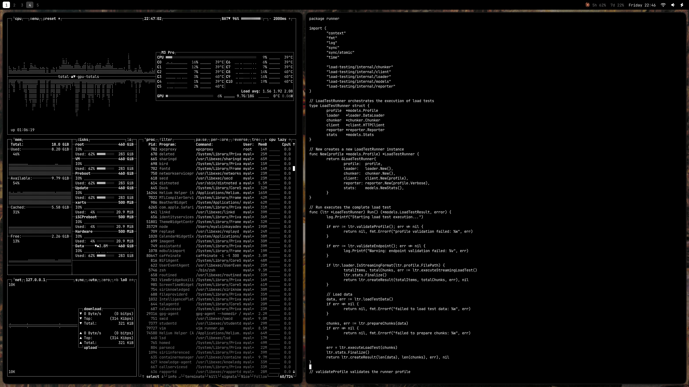

## Built for coding agents

omv is a desktop for working alongside coding agents. Claude Code, Codex, OpenCode and pi report to the bar, so you see every session without hunting through terminals:

- **A pill when a session waits for you.** It shows the project, with `?` when the agent is blocked on your approval. Click it, or press Option+Shift+A, to land in that session's terminal, on any workspace or tab.
- **Send to agent.** Option+P puts the selected text, what you copied, or a screenshot of a region into the prompt of an agent that finished and waits for you.
- **One inbox.** The pill and Option+Shift+A open one screen: what needs you, what's done, and after a break, which sessions ended and the pull requests you opened.
- **The Agents card.** Claude's session and weekly limits, every live session with its state and how long it has been in it, background sessions, and one key to continue or start one.
- **Dev layout.** Your editor, Claude Code and a shell side by side on their own workspace, optionally on a fresh git worktree, so a task can't collide with other work.
- **Agent grid.** Two to four agents on one project, each on its own branch, as panes of one window.

[Agents](#agents) and [Dev layout](#dev-layout) have the details.

### Let your agent set it up

Ask your agent for "smaller gaps", "Option+Q closes the window" or "a bigger terminal font". Your own settings live in `~/.config/omv/`, outside the omv folder, so an agent can change them freely and `omv update` still works. [AGENTS.md](AGENTS.md) tells any agent which file holds what, how to apply a change with `omv reload`, and how to check it with `omv doctor`. Point your agent at it, or let it find it in the omv folder.

### Install in a minute

```sh
git clone https://github.com/myalcinkayadev/omv.git && cd omv
bin/omv install
```

This opens omv Setup, a window that runs the install step by step, then walks you through the permissions only you can grant. Only Accessibility is needed, for tiling; the rest are optional, and each step shows what it turns on. It needs [Homebrew](https://brew.sh) and Xcode's Command Line Tools; [Install](#install) has the details and what it changes.

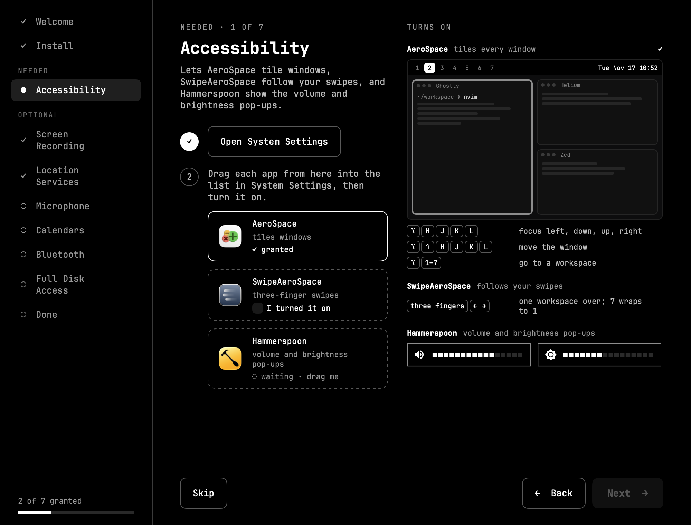

Before you trust it:

- `bin/omv install --dry-run` prints every step it would run and changes nothing.
- omv never asks for your password itself. Homebrew may, for an app it puts in /Applications.
- Everything it runs is in [`install/install.sh`](install/install.sh), a plain shell script.
- `omv uninstall` takes it back out; [Uninstall](#uninstall) says what it removes and what stays.

## Features

- [**Tiling and workspaces**](#tiling-and-workspaces): six workspaces with fixed homes for each app plus a dev workspace, Vim-style keys, Option+Tab back to the last workspace, a tabbed layout, a focus border, and three-finger swipes.
- [**The bar**](#the-bar): workspaces, the playing track, reminders, meetings, Claude usage, and a macOS-style clock that stays clear of the notch.
- [**Palette**](#palette): Option+Space finds any window, app or omv command as you type, pastes your snippets, works out sums, and converts units, currencies and dates.
- [**Key list**](#key-list): Option+/ shows every shortcut at once, and runs the one you pick.
- [**System menu**](#system-menu): lock, sleep, restart and reload the tools.
- [**Sound**](#sound): volume, mute, output and input devices, a live mic level, Option+O for the next output, and Option+M to mute the mic from anywhere.
- [**Wi-Fi and Ethernet**](#wi-fi-and-ethernet): the network, signal, address and router, a click away.
- [**Agents**](#agents): Claude Code's session and weekly limits, one click to continue or start a session, and a pill when a session waits for you.
- [**Battery**](#battery): charge, time left, cycles and power draw.
- [**Weather**](#weather): the temperature in the bar, and a three-day forecast for wherever the Mac is.
- [**Your own workspaces**](#your-own-workspaces): which workspaces there are, the screens each goes on, the apps that live there and each screen's gaps, in one file, applied as displays come and go.
- [**Dictation**](#dictation): hold Right Option to talk and release to type it, in any app, heard on the Mac.
- [**Meeting mode**](#meeting-mode): Do Not Disturb, paused music and hidden chat apps while a meeting runs, all back as they were when it ends.
- [**Calendar and today's events**](#calendar-and-todays-events): click the clock for the month and today's Calendar.app events.
- [**Reminders and Pomodoro**](#reminders-and-pomodoro): `25m check deploy`, or `pomo` for focus blocks with break cards and a long break after every fourth.
- [**Disk**](#disk): free space in the bar once it runs low, and Mole's cleanups a key away.
- [**Lyrics**](#lyrics): the playing song's lyrics in a window that tiles, the line being sung large in the middle.
- [**Capture menu**](#capture-menu): screenshots, text and QR codes from the screen, a color picker, and screen recordings.
- [**Volume and brightness**](#volume-and-brightness): omv's own pop-ups, and the brightness keys dim an external display too.
- [**Do Not Disturb**](#do-not-disturb): the Focus that's on, in the bar, and a switch in the system menu.
- [**Tailscale**](#tailscale): connect, disconnect, and copy any device's address.
- [**Night light**](#night-light): macOS's Night Shift on a key, with a moon in the bar.
- [**Input source**](#input-source): the keyboard layout in use, as `TR` or `US`, in the bar; click it for the next one.
- [**Camera and mic in use**](#camera-and-mic-in-use): a green camera and an orange mic in the bar while an app uses them.
- [**Dev layout**](#dev-layout): a project's editor, Claude Code and a shell on a workspace of their own, a new task in a git worktree, or a grid of agents.
- [**Share with AirDrop**](#share-with-airdrop): the files selected in Finder, or what you copied, in one key.
- [**Translate**](#translate): Option+Y translates the selected text with Apple on the Mac, DeepL or Claude, and pastes it over the selection.
- [**Smaller tools**](#smaller-tools): keep the Mac awake, CPU and memory in the bar while the Mac is busy, copy the browser's URL, a drop-down terminal, and notifications when long commands finish.
- [**Feature flags**](#feature-flags): turn off any feature you don't use, with its key, card and bar item.
- [**Doctor**](#doctor): `omv doctor` checks the tools, links, running services and settings, and says how to fix whatever is wrong.

Every card shares one design: a black card with a gray border, a title that doubles as a search field, and Up, Down, Enter and Escape to drive it. With two displays, a card opens on the one the pointer is on, so a click on the bar opens it on that display. A card that belongs to a bar item, such as Agents, Wi-Fi or the calendar, opens just under that item.

## Tiling and workspaces

Every shortcut starts with Option. Option alone goes somewhere or acts on the current window, and adding Shift takes the window with it or launches an app. H/J/K/L mean left, down, up and right, as in Vim.

| Workspace | Apps | Monitor |
|---|---|---|
| 1 | Ghostty | Main |
| 2 | Zed | Main |
| 3 | Helium | Main |
| 4 | Obsidian, Notion, Linear | Secondary, or main if there is only one |
| 5 | Notes, Messages, WhatsApp, Discord | Secondary, or main if there is only one |
| 6 | Apple Music, Spotify | Secondary, or main if there is only one |

- **Each app opens on its workspace.** Finder tiles on the current workspace instead, though its Get Info windows float, and System Settings and Calculator float there.
- **Seven workspaces in total,** not seven per monitor, because AeroSpace workspaces are global. The seventh is the [dev layout's](#dev-layout), on the main monitor. A pinned workspace always opens on its own monitor, so Option+4 from the main monitor moves focus to the secondary one. When the secondary display is unplugged, workspaces 4-6 move to the main one, and they return when it's plugged back in. [Your own workspaces](#your-own-workspaces) changes how many there are and where each sits.
- **Focus border:** the focused window gets a 2pt gray outline, the same gray as the cards' border, drawn by [JankyBorders](https://github.com/FelixKratz/JankyBorders). It starts with AeroSpace. It's drawn at 1x (`hidpi=off`), which takes about 40 MB instead of up to 209 MB. For a sharper outline on Retina, change `hidpi=off` to `hidpi=on` in `aerospace.toml`, then run `pkill -x borders` and restart AeroSpace.
- **Trackpad:** swipe three fingers left or right to move one workspace, wrapping around. A swipe stays on the focused monitor, so with two monitors it cycles 1-3 on the main one and 4-6 on the secondary.
- **Option+Tab** goes back to the previous workspace.
- **Tabbed layout:** Option+A switches the workspace between tiles and tabs. In tabs, the focused window takes almost the whole width and the others peek out at the edges, which suits a laptop screen. Option+H / L move between them. AeroSpace remembers the layout per workspace.
- **Dragging:** Ctrl+Cmd+drag moves a floating window by any part of it. A tiled window snaps back to its tile when you let go.
- **Sizing a window:** Ctrl+Option+Left and Right put the focused window in the left or right half; pressed again, a third, then two-thirds. Ctrl+Option+Up makes it almost full, Down centres it at two-thirds, and C centres it as it is. All stay inside the gaps the tiles use, below the bar. A tiled window is floated first, and Option+T puts it back in the tiles.
- **Resize mode:** Option+Shift+R, shown as `RESIZE` in the bar. H / L make the window narrower / wider, and K / J shorter / taller. Escape or Enter leaves, and other shortcuts stay off until you do. Height only changes when windows are stacked vertically.
- **btop** opens on workspace 1 when AeroSpace starts, unless one is already running.

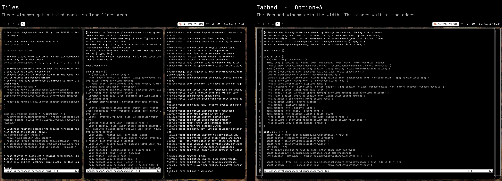

## The bar

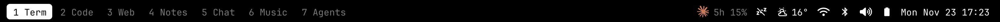

**On the left**, workspace numbers: the focused one is a white pill, and the one visible on the other monitor is a gray pill. Click a number to go there, or scroll over them to move one workspace at a time across all seven, wrapping around. The binding mode shows next to them while it isn't the normal one.

While Music or Spotify plays, the track follows as `Artist — Title`, cut at 40 characters. Click it to play or pause, right-click it for the [lyrics](#lyrics), and scroll for the next or previous track. It hides when nothing plays and never opens a player that is closed.

**On the right**, from left to right:

| Item | Shows | Click | Scroll |
|---|---|---|---|
| Meeting | The next Calendar event's start time, from an hour before | Join its video call, or open the [calendar](#calendar-and-todays-events) | |
| Reminder | Time left on the next reminder, plus `+N` for others | List them, to cancel one | |
| Checks | The checks on your own open pull requests, checked with `gh` every 5 minutes: a white pill with how many fail, or a gray count of those still running. Hidden when all passed, when you have none open, or when `gh` is missing, logged out or offline | List them, failing first; Enter opens one in Helium | |
| Pull requests | How many open pull requests ask for your review, checked with `gh` every 5 minutes. Hidden when none wait, or when `gh` is missing, logged out or offline | List them; Enter opens one in Helium | |
| Claude | The 5-hour usage limit, as `5h 23%` | Open the [Agents card](#agents) | |
| Waiting Claude | A white pill right of Claude's limit, `omv`, while a Claude Code session waits for you, or `? omv` while it asks for approval, plus `+N` for others | Go to that session's terminal, or pick one when several wait | |
| Outdated packages | How many Homebrew packages `brew outdated` lists, with [`brew-outdated`](#feature-flags) on | Run `brew upgrade` in a new Ghostty window; see [Smaller tools](#smaller-tools) | |
| System load | `CPU 92%` past 80% of all cores, and `mem high` or `mem critical` under memory pressure, only while busy; off unless the `system-load` flag is on | Open [hungry processes](#smaller-tools) | |
| Disk | Free space on the startup disk, only while it's under 20 GB or under 10% | Open the [Disk card](#disk) | |
| Keep-awake | A crossed-out Zzz, while keep-awake is on | Turn it off | |
| Weather | Condition and temperature, where the Mac is | Open the [weather card](#weather) | |
| Input source | The keyboard input source, as `TR` or `US`, only with `omv flags input-source on` and more than one enabled | Switch to the next [input source](#input-source) | |
| Ethernet | A plug, only while a cable is connected | Open the [Ethernet card](#wi-fi-and-ethernet) | |
| Bluetooth | On or off, only with `blueutil` installed | Open the [Bluetooth card](#bluetooth) | |
| Wi-Fi | Connected or not | Open the [Wi-Fi card](#wi-fi-and-ethernet) | |
| Volume | Level | Open the [Sound card](#sound), with either button | Change the volume by 5% |
| Battery | Charge | Open the [Battery card](#battery) | |
| Clock | Date and time, as `Sun Nov 8 12:09` | Open the [calendar](#calendar-and-todays-events) | |

**Clear of the notch:** when the right side gets too full, items give way in this order until it fits: Claude's limit (its logo stays), then the meeting's time (its icon stays), then the weather's temperature (its icon stays), then the Claude logo. The input source, keep-awake, low disk space, outdated packages, a busy CPU or memory, the waiting Claude, the pull request count, the failing checks, the reminder and the status icons always stay, and everything comes back once there's room.

**Claude usage** shows the 5-hour limit: gray under 70%, white from 70%, and a white pill from 90%. The 7-day limit is in the [Agents card](#agents).

- The numbers come from Claude Code's status line, so they only update while Claude Code runs. Usage from elsewhere, such as claude.ai, shows after your next response in Claude Code.
- A window past its reset time shows 0%.
- Once the 5-hour limit reaches 90%, a reminder is set for its reset, "Claude's 5-hour limit has reset", once per reset.
- `omv install` adds one line to `~/.claude/statusline-wrapper.sh` through `agents/claude-usage.sh`. If that file doesn't exist, the item stays hidden.
- Only the four numbers are stored, in `~/.local/state/omv/claude-usage`.

**Checks** follow your own open pull requests in every repository, with one `gh` search, so there's no repository to set up. A pull request whose checks went from failing to passing gets a notice; a click on it opens the pull request. The last answer is kept in `~/.local/state/omv/github-ci`, so the card opens at once, and a failed check stays failing while GitHub can't be reached.

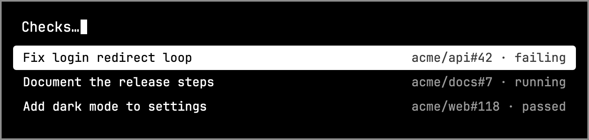

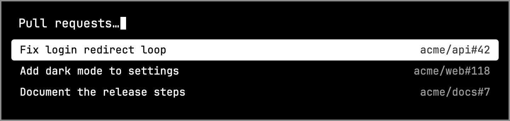

Option+Shift+Space shows or hides the bar.

## Palette

Option+Space opens one list, like Omarchy's: every open window with its app and workspace, then your [snippets](#snippets), then every app in `/Applications`, `/System/Applications` and `~/Applications`, then every omv command the [key list](#key-list) can run, such as the Wi-Fi card or the capture menu. Type to filter by name, app, workspace number or key, and press Enter to go to the window, open the app or run the command.

Type a sum, such as `2*35`, and its result shows first: `= 70`. Enter copies it. It reads `+ - * / ^`, `%` for the remainder, brackets and decimals. A lone number, or a name with digits such as `omv-14`, filters as usual.

It converts too, with Enter copying the result the same way:

- **Units:** `5 km to mi`, `100 f in c`, `1.5 GB to MB`, `90 min to h`, `100 km/h to mph`. Length, mass, volume, temperature, data, time and speed. GB and MB are decimal; GiB and MiB are binary.
- **Currencies:** `100 usd to eur` or `3 euro to lira`, with any two three-letter codes or the common names: euro, dollar, lira (or tl), yen, franc, yuan, ruble. Rates come from [Frankfurter](https://frankfurter.dev), free and keyless, and only once a currency is typed. They're saved in `~/.local/state/omv/rates.json` and fetched again once 4 hours old. The rate's date shows beside the result. Offline, the saved rates still work.
- **Dates:** `today + 30 days`, `2027-01-31 + 1 month`, `in 3 weeks`, `days until 2026-12-25`, `days since 2026-11-10`. A month added to the 31st keeps to the last day of a shorter month.

**Clipboard actions.** Open the palette with something on the clipboard that has a shape omv knows, and a **Clipboard** row comes first, already selected, its kind in a tag:

| Copied | Row | Enter copies |
|---|---|---|
| JSON | `JSON` Pretty JSON · 12 lines | the JSON, indented |
| A JWT | `JWT` JWT · HS256 · sub 1042, and `valid · 2 h left` in green or `expired 3 h ago` in red | its payload as JSON |
| `1732190400`, or 13 digits | `TIME` the date, in your time zone | the date |
| Text with `%xx` escapes | `URL` the decoded text | the decoded text |
| Base64 of readable text | `B64` the decoded text | the decoded text |

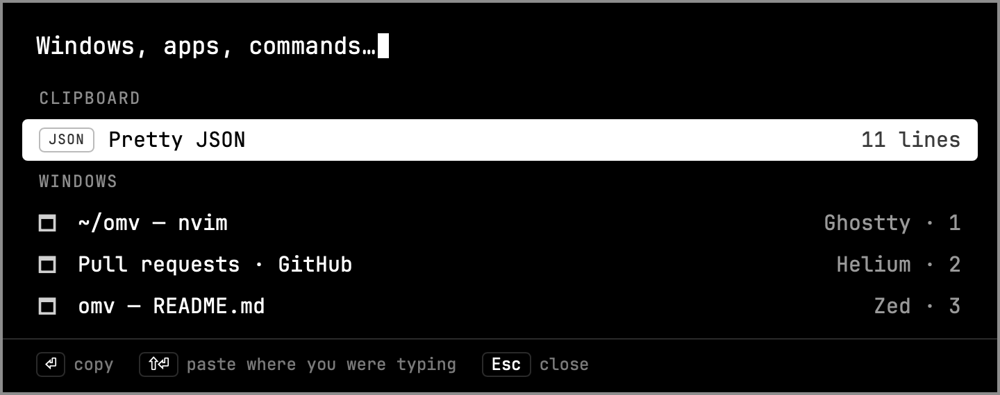

Shift+Enter pastes it where you were typing instead, as [snippets](#snippets) do. Ordinary text gets no row, and typing anything else hides it.

Type an action word to choose yourself: `json`, `jwt`, `b64`, `unb64`, `url`, `unurl` or `epoch`. On its own it works on the clipboard; with text after it, on that text, so `b64 hello` encodes and `epoch 1732190400` reads a date. Two letters list the words that match. Input that doesn't fit says so, such as `Not a JWT`.

Everything happens on the Mac, in the palette's page. The clipboard isn't read while clipboard history is paused, for a copy a password manager marks as concealed, or over 100 KB. `omv flags clipboard-actions off` turns it off.

### Snippets

Text you type often, such as a reply or a sign-off, kept in `~/.config/omv/snippets`, one per line:

```
# name = text; \n is a line break
reply = Thanks, I'll take a look today.
email = me@example.com
sign = Best regards,\nAlex
```

In the palette they're listed under Snippets, by name with the start of the text beside it. Type a name, press Enter, and the text is pasted where you were typing. omv puts it on the clipboard, waits for that window to have focus again, then presses Cmd+V, so the text stays on the clipboard afterwards. When that window doesn't come back, or Hammerspoon lacks Accessibility, it's only copied, and a notice says so. The file is read each time the palette opens, so an edit shows at once.

**File search** is off unless you turn it on:

```sh
omv flags file-search on
```

That writes `file-search=on` to `~/.config/omv/flags` and reloads Hammerspoon. `omv flags` lists every flag and whether it's on; [Feature flags](#feature-flags) has them all.

Then, after 3 or more typed characters and a short pause, the palette lists up to 20 files whose names contain every typed word, under Files, names starting with the first word first, then the newest: files you opened or changed in the last 30 days, in your home folder, leaving out `Library`, `node_modules` and `.git`. Enter opens one with its app, Cmd+Enter shows it in Finder, and Cmd+C copies its path. It asks Spotlight (`mdfind`) in the background, one search at a time, so typing never waits for it. While the flag is off, no search runs.

**Browser tabs** are off unless you turn them on with `omv flags browser-tabs on`. Then the palette lists every tab open in your browser under Tabs, after the windows and snippets and before the apps: its title, or its URL when it has none, with the site's host beside it. Typing filters them like any row, and Enter shows that tab, brings its window to the front and switches to the browser. The browser is the one in `~/.config/omv/apps` (`browser = Safari`), else Helium; Safari and the Chromium browsers, such as Helium, Chrome and Brave, work. One `osascript` reads all the tabs in the background each time the palette opens, so the palette never waits: the tabs appear a moment later, or not at all when the browser isn't open or takes over 3 seconds. The first time, macOS asks to let Hammerspoon control the browser; until you allow it in System Settings, Privacy & Security, Automation, no tabs show. A browser name holding a quote or backslash is refused.

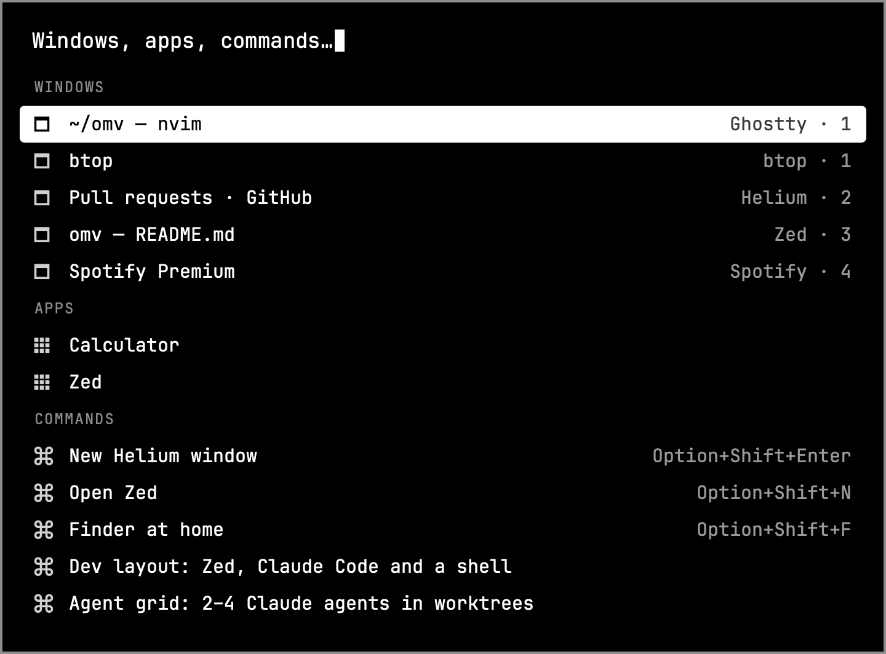

## Key list

Option+/ shows every key at once, in a searchable two-column list. Type to filter by description or key, and press Enter (or click) on a row to run that shortcut: the list closes, focus goes back to your window, and the action runs. The list is built from `aerospace.toml` and `init.lua`, so it never goes stale.

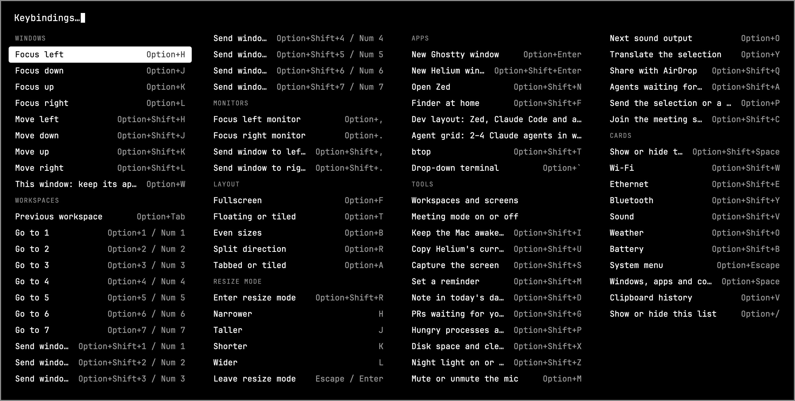

## System menu

Option+Escape opens a menu modeled on Omarchy's.

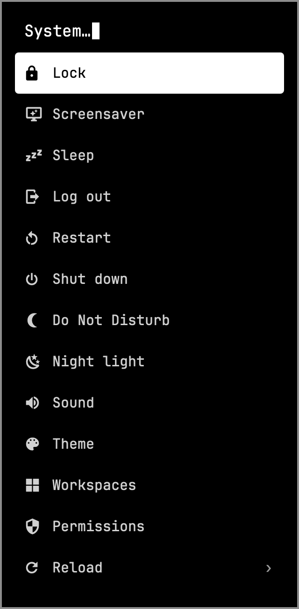

| Item | Does |
|---|---|
| Lock | Locks the screen |
| Screensaver | Starts the screensaver |
| Sleep | Puts the Mac to sleep |
| Log out, Restart, Shut down | Ask first, with Cancel selected |
| Do Not Disturb | Switches [Do Not Disturb](#do-not-disturb) on or off |
| Sound | Opens the [Sound card](#sound) |
| Theme | Opens the [theme picker](#themes) |
| Workspaces | [Your own workspaces](#your-own-workspaces): workspaces, their screens and apps, and each screen's gaps |
| Permissions | Each permission omv needs, ✓ granted, ✗ not, or ? to check by hand; Enter opens its System Settings pane. Opens on its own the first time omv loads |
| Reload › | Reloads AeroSpace, SketchyBar, Hammerspoon, or all three |

Type to filter, Up and Down to move, Enter or Right to pick, Left or Backspace to go back, and Escape or a click elsewhere to close.

## Themes

Option+Escape, then **Theme**, picks the colours for the cards, the bar, Ghostty and the focused window's outline. **Vantablack** is built in and stays the default. **Get Omarchy's themes** downloads the colours of [Omarchy's](https://github.com/basecamp/omarchy) themes (MIT), such as Tokyo Night, Gruvbox and Nord, and lists them; nothing else is fetched, and only when you pick it.

- **Cards** take the new colours at once. Each gray keeps its place between the theme's background and foreground, so a theme recolors every card without changing its look.
- **The bar** reloads with the theme's colours.
- **Ghostty** takes them in new windows, or after its own config reload, Cmd+Shift+,.
- **The focused window's outline** takes the theme's accent.
- **The lyrics window** redraws in the new colours at once.
- **By the clock:** name a day theme and a night theme in `~/.config/omv/theme-clock`, such as `day = catppuccin-latte` and `night = vantablack`, one a line. The theme switches at sunrise and sunset where the Mac is, worked out on the Mac from the location Hammerspoon already has for the [weather](#weather), so nothing is fetched and it never asks for the location itself. Without a location, or where the sun doesn't rise or set that day, day runs from 7:00 to 19:00. It switches only when day turns to night or back, checked every 5 minutes and on wake, so a theme you pick by hand stays until the next sunrise or sunset. A name that isn't a theme you have is skipped, so get Omarchy's themes first.
- The choice is saved in `~/.local/state/omv/theme`, so it survives reloads and restarts. Neovim and btop keep their own colours.

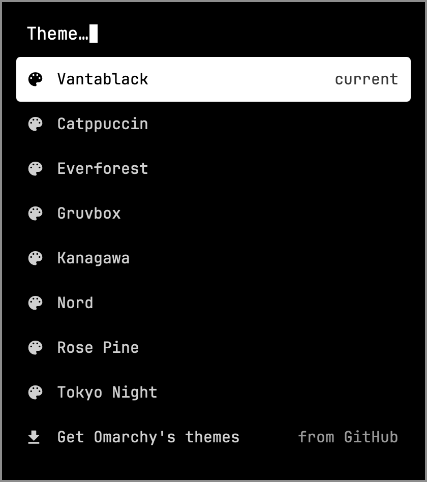

## Sound

Click the volume item in the bar, or press Option+Shift+V, for the Sound card under it.

- **Header:** the output in use, and a switch that mutes and unmutes.
- **Output:** a volume slider, then every output device, with the one in use highlighted. Click one to switch to it. They're read each time the card opens, so AirPods show up as soon as they connect.
- **Input:** a volume slider for the mic, a live level meter, then every input device.
- Virtual devices, such as the ones Zoom and Teams add, are left out unless they're in use.
- **Keys:** Up and Down move through the devices, Enter picks one, Left and Right change the volume by 5%, M mutes, and Escape or a click elsewhere closes.
- **Live:** while the card is open, it follows changes made elsewhere: the volume keys, mute, and devices connecting or switching. A slider you're dragging keeps its place.
- **The level meter** comes from a small Swift helper, `meter.swift`, built the first time into `~/.cache/omv/Meter.app`. It listens only while the card is open, so macOS shows its orange microphone dot until the card closes. The first time, macOS asks to let "omv meter" use the microphone. If you refuse, the meter stays empty and the rest of the card still works.

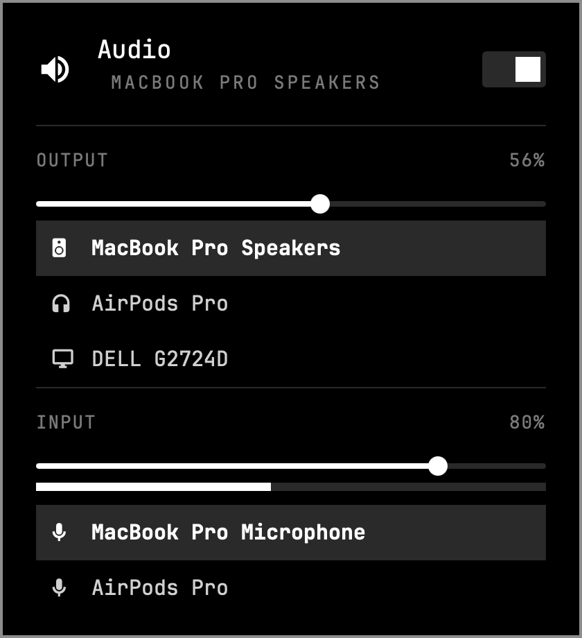

**Next output.** Option+O switches to the next output, in the card's order, and a notice names it. A virtual device, such as Zoom's, is skipped unless it's in use.

**Mic mute.** Option+M mutes or unmutes the mic from any app, so a meeting never needs its own window in front to go quiet. While it's muted, a red mic shows in the bar; click it to unmute.

- A mic that can be muted is muted. One that can't, such as some USB mics, is set to volume 0, and its level comes back when you unmute.
- Switching mics while muted, such as AirPods connecting, mutes the new one too, so the red mic never shows while a mic is live. Unmuting unmutes every mic that's muted.
- It survives a Hammerspoon reload: the red mic comes back. The level to restore is kept in `~/.local/state/omv/mic` until you unmute.

## Wi-Fi and Ethernet

Click the Wi-Fi item, or press Option+Shift+W, for the Wi-Fi card: the network's name, the signal as a percentage and in dBm, the IP address, the router and the channel. **Turn off** (or **Turn on**) switches Wi-Fi, and **Settings** opens Wi-Fi in System Settings.

The Ethernet item shows only while a cable is connected. Click it, or press Option+Shift+E, for the Ethernet card: the link speed, the IP address, the router, the port and the duplex, and **Settings** for Network in System Settings. With more than one cable, it shows the one the Mac's traffic goes out by.

Both cards have **Speed test**: macOS's own `networkQuality` measures the download and upload speed against Apple's servers in about 15 seconds, and the card shows them under Download and Upload until the next test.

Left and Right move between the buttons, Enter presses one, and Escape or a click elsewhere closes.

Both cards follow changes while they're open, such as Wi-Fi turning off, joining a network, the signal or a cable being unplugged, and keep the selected button. The bar's Wi-Fi and Ethernet icons change at once too: Hammerspoon watches for these changes rather than checking on a timer.

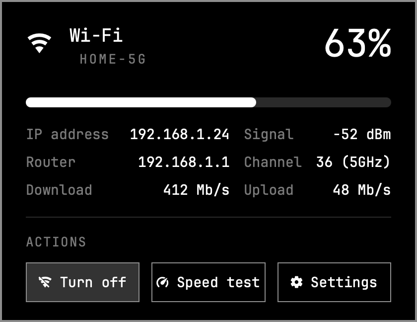 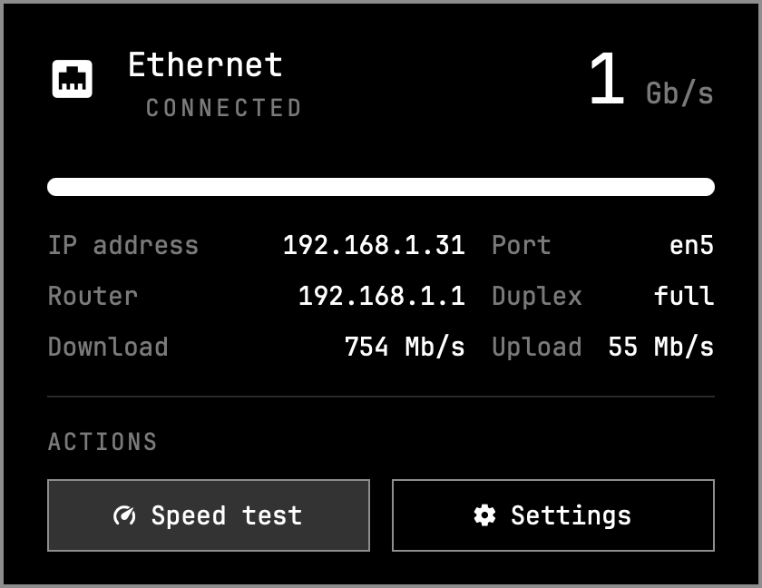

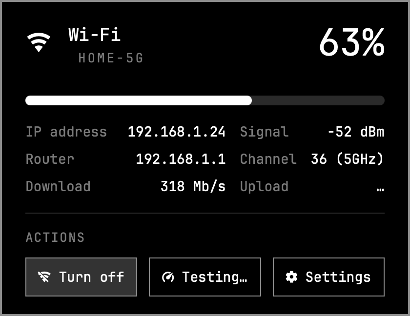

Since macOS 14, an app needs Location Services to read the Wi-Fi network's name. Hammerspoon asks for it once, for the weather, and without it the card shows `—` for the name.

## Bluetooth

Click the Bluetooth icon, or press Option+Shift+Y, for the Bluetooth card under it: a switch that turns Bluetooth on or off, then your paired devices, connected ones first. Enter on a device connects or disconnects it, which takes a few seconds; the card redraws when it's done.

- Paired devices are listed under **My devices**, and the search under **Nearby**. **Pair a new device…** searches for devices in pairing mode for as long as the card is open, up to 2 minutes, and lists the ones not yet paired as each 10-second round ends; Enter on the searching row stops it. Dimmed lines, such as "Put the device in pairing mode", are only text: the selection passes them by. Enter on a device pairs and connects it, and its row says pairing…, then connecting…, and it's selected among the paired devices when done. A failed pairing says so with Enter to retry; a second failure points to Bluetooth Settings. Pairing and connecting give up after 20 seconds.
- The search finds classic Bluetooth devices, such as AirPods, speakers and most headphones. Bluetooth Low Energy devices, such as many newer keyboards and mice, don't show up, and a device that asks you to type a PIN can't be paired here: when nothing is found, the card points to Bluetooth Settings.
- Connecting or disconnecting a paired device shows connecting… or disconnecting… on its row, and couldn't connect when it fails. The selection stays on the row you chose while the card redraws.
- **Bluetooth Settings**, the last row, opens System Settings for anything else, such as those devices or forgetting one.

- It reads and changes Bluetooth through [blueutil](https://github.com/toy/blueutil): `brew install blueutil`. Without it, the bar item stays hidden and the card says how to install it.
- Hammerspoon needs Bluetooth access: System Settings > Privacy & Security > Bluetooth, turn on Hammerspoon (add it with + if it's not listed). macOS may not ask by itself. Until then, the bar item stays hidden and the card's one row opens that setting. The bar reads Bluetooth's state through Hammerspoon, so SketchyBar needs no access of its own.

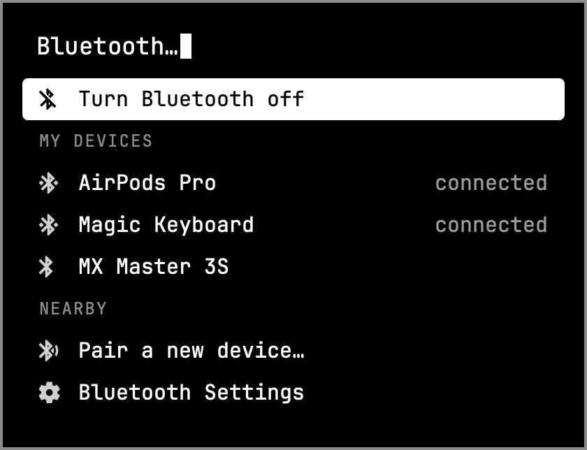

## Agents

Click Claude's item in the bar for the Agents card: Claude Code's plan, and bars for the session (5-hour) and weekly limits with the time until each resets.

- **>_** continues your last Claude Code session, in the folder it ran in, with `claude --continue`.
- **+** lists the folders you've used Claude Code in, most recent first. Type to filter, and Enter starts a new session there.
- **󰋚** lists your recent sessions, newest first, each named by the title Claude Code gave it, else by its folder, with the folder and its age, such as `omv · 2h ago`. Type to filter, and Enter resumes it with `claude --resume`.
- All three open a Ghostty window on workspace 1. Left and Right move between the buttons, and Enter presses one. Folders that no longer exist are left out of all three.
- **Sessions:** under the limits, a row for each live Claude Code session, with its folder, its state and how long it has been in it, such as `asks · 3 min`. Sessions asking for approval come first, then the ones done, then the ones working. Down and Up move through them, and Enter goes to that session's terminal. With no session running, the card looks as before.
- **Background:** Claude Code's background sessions, the ones started with `claude --bg` or moved there with `/bg`, are listed under BACKGROUND, by name with their folder and state, such as `sila-v1 · asks`. They're read from `claude agents --json`, so they show even with the background service off. Enter opens one in a new Ghostty window on workspace 1, with `claude attach`. Hovering one shows a × at its right; clicking it, or `x` on the selected row, removes it after asking with Cancel selected: it runs `claude stop` and `claude rm`, so it leaves the list but its conversation stays, for `claude --resume`. When Claude's background service isn't running, it's started just for this and stopped after, leaving other sessions running.
- The plan comes from `~/.claude.json`, and only its `organizationType` is read. The folders come from Claude Code's own session files in `~/.claude/projects`.
- `claude` runs through your login shell, by `claude-in.sh`, so it's found on the PATH your shell sets up.

**Other agents.** Codex, OpenCode and pi sessions show in the same pill, list and Agents card as Claude's, with the agent's name in the card, such as `codex · asks · 3 min`. Each reports through the same hook script as Claude Code, and `omv install` sets up only the agents it finds:

- **Codex** (`~/.codex`): `agents/codex-hooks.sh` adds hooks to `~/.codex/hooks.json` for when you send a prompt, a tool runs, Codex asks for approval, and it stops. Other hooks, such as herdr's, stay. Codex asks once to trust new hooks: run `/hooks` in Codex.
- **OpenCode** (`~/.config/opencode`): a plugin, `omv-agent-state.js`, is linked into its `plugins` folder. Subagents' sessions are left out; their parent stands for them.
- **pi** (`~/.pi/agent`): an extension, `omv-agent-state.ts`, is linked into its `extensions` folder. pi asks for no approvals, so its sessions are working or done.
- `omv uninstall` removes all three, and `omv doctor` checks each agent that's set up.

**Waiting sessions.** When Claude Code finishes or asks for approval, a white pill shows the session's folder, as `? omv` when it asks for approval, since that one is blocked until you answer. It sits right next to Claude's logo and 5-hour limit, so the two read as one group, and the limit stays in view. Click it, or press Option+Shift+A: with one session waiting, you land in its terminal, even in another tab or on another workspace. With more, the **agents' inbox** opens: a title with a count line, such as `1 asks · 2 done`, and at its right how many need you; then **Needs you** (●, with how long ago it asked) and **Done** (✓, with when it finished), the one waiting longest first in each, and **While away** after a break. Enter goes to a session's terminal, or opens a pull request. The pill goes when you answer, when a tool runs after your approval, or when the session ends. Working sessions never show in the pill, only in the Agents card.

- **Seen sessions leave the pill.** While Ghostty is in front, the session in the terminal you're looking at is marked seen, so it leaves the pill until its state changes: a session that finishes, then asks, shows again. Ghostty is read only while it's in front: when you switch to another of its windows or tabs, and every 5 seconds for a switch of split.
- **A notification when a session asks.** A session that starts asking for approval in a terminal you're not looking at sends a notification, "omv · needs your approval". Clicking it goes to that session. A session that only finishes never notifies; the pill covers that.

- `omv install` adds hooks to `~/.claude/settings.json` through `agents/claude-hooks.sh`: `UserPromptSubmit` and `PostToolUse` mark a session as working, `Stop` as done, a `Notification` that asks for you, such as one for approval, as asking, and `SessionEnd` removes it. Other notifications change nothing. Other hooks and settings stay as they are, and `omv uninstall` removes only these.
- The session's terminal is found by its tty, in Ghostty, iTerm2 or Terminal, through each app's AppleScript, Ghostty first. A terminal app that isn't running is skipped, so it never opens on its own. The first time, macOS asks to let Hammerspoon control that app.
- Only Claude's PID, its tty, the folder name, the state and when the session entered it are saved, in `~/.local/state/omv/claude-sessions`. A session whose Claude has ended is dropped within 30 seconds.
- A session in any other app, such as Zed's terminal, still shows. Since no terminal app has its tty, the app it runs in comes forward instead, found among Claude's parent processes; macOS can't pick the exact window or pane. The drop-down terminal can't be focused.

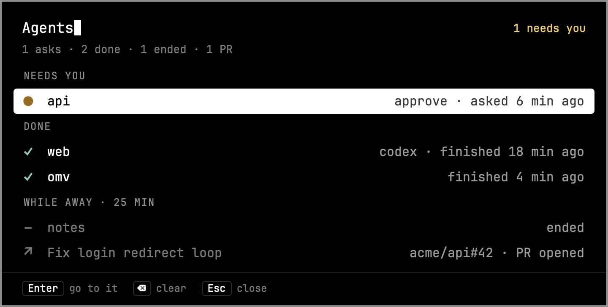

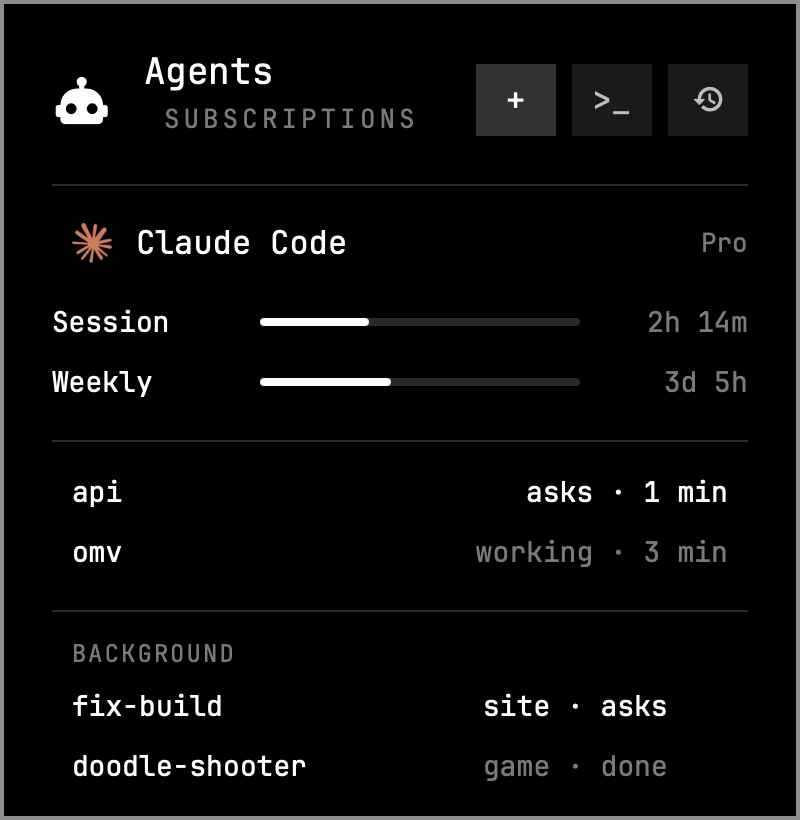

**Send to agent (Option+P).** Select text anywhere, such as a stack trace in the browser, and press Option+P. A card lists every agent session that finished and waits for your next prompt; pick one, and its terminal comes forward with the text in the prompt. With nothing selected, it offers what you copied instead. Each session also has a **Screenshot** row: drag over a region, and the screenshot's path lands in the prompt, which Claude Code reads as an image.

- Only sessions that are done are listed. One that asks for approval could take the paste as its answer, and one that works may start asking at any moment, so neither is offered, and a session that started again since the card opened gets a notice instead of the paste.
- Enter is never pressed: you read what landed and send it yourself. Trailing newlines and control characters are dropped, so a paste can't send itself or break out of the terminal's paste.
- The clipboard is put back as it was half a second after the paste. Without Accessibility for Hammerspoon, or when the session's own terminal can't come forward, the text is only copied, for you to paste with Cmd+V.
- Screenshots go to `~/.local/state/omv/agent-shots`, and those older than a day are removed when the next one is taken.

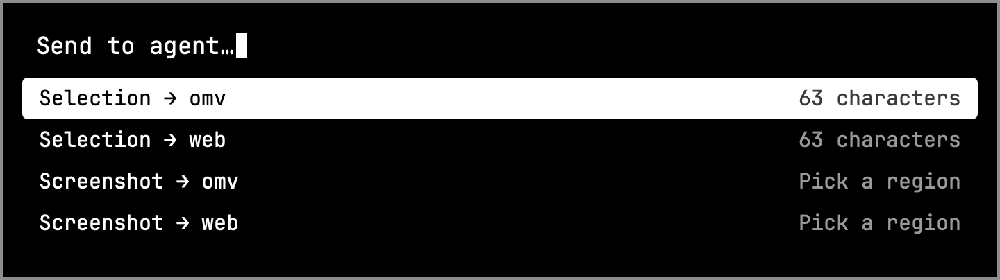

**Away digest.** Unlock the screen after at least 5 minutes away, or the minutes set in `~/.config/omv/away-digest` such as `minutes = 10`, and if anything changed meanwhile, the agents' inbox opens on its own. Under its **While away · 25 min** section are the sessions that ended (–) and the pull requests you opened (↗), from `gh`; they stay until you clear each with Backspace. The sessions that wait are in Needs you and Done above it, from their live state.

- It needs no more than the sessions' saved state: each one says when the session entered its state, so the sessions as they were at the lock and as they are now are compared. Nothing else is recorded, so it can't say which files changed.
- The break starts when the screen locks or the Mac sleeps, and ends when you unlock it. A Mac that never asks for a password never unlocks, so it shows no digest.
- `gh` gets 5 seconds; offline, or without `gh`, the inbox opens without pull requests.

## Battery

Click the battery item, or press Option+Shift+B, for the Battery card: the charge, whether it's draining, charging or charged, the battery's size in Wh, the time left (or to full), the charge cycles and the power going in or out.

While the card is open, it follows the charge and charging as they change, and the bar's battery icon changes with them.

**Battery settings** opens System Settings, where Low Power Mode is. The card doesn't switch it itself: macOS lets only its own apps do that without an admin password.

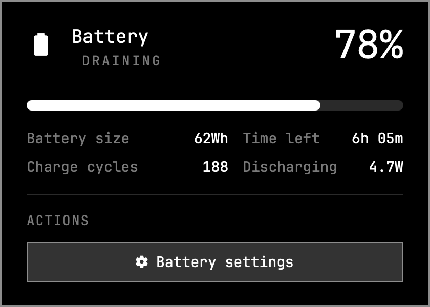

## Weather

The weather item shows the condition and the temperature where the Mac is. Click it, or press Option+Shift+O, for the weather card:

- **Now:** the temperature and the sky in words, what it feels like, and today's high and low. Beside it, an arc shows where the sun is between sunrise and sunset, and how long until the next of them.
- **Details:** wind with an arrow for where it blows, humidity, and the UV index with its level, from low to extreme.
- **A summary** of what matters most in the next hours: when rain comes and when it's heaviest, or where the temperature goes and when fog sets in.
- **The next twelve hours** as one temperature line, labelled every hour. The sky's icon shows only where it changes, and a band along the top shades it hour by hour. Night is shaded from sunset, and rain shows as columns by strength, light, moderate or heavy, with the strongest named. Point at an hour, or use Left and Right, to read its temperature, sky, rain and UV.
- **The next three days,** each a bar from its low to its high, all on one scale so a cold day reads colder.
- Opening the card plays a short animation, unless reduced motion is on in System Settings > Accessibility > Display.

- The location comes from macOS's Location Services. The first time, macOS asks to let Hammerspoon use it. The city's name comes from macOS too.
- The weather comes from [Open-Meteo](https://open-meteo.com), which needs no key. Only the location, rounded to about a kilometre, is sent.
- It's read when Hammerspoon starts, every 30 minutes, when the Mac wakes, and when the card opens.
- When a reading fails, the last one stays. With none yet, the item stays hidden and the card says why.

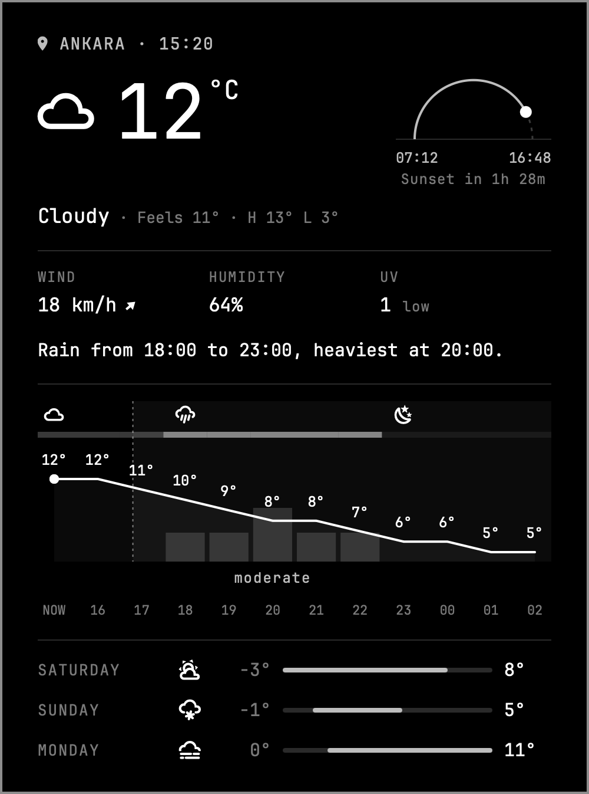

## Calendar and today's events

Click the clock for a calendar card. Weeks start on Monday and show their ISO week number, today is a white square, and the footer shows today's date and week. Left and Right (or ‹ and ›) change month, T goes back to today, and Escape or a click elsewhere closes it.

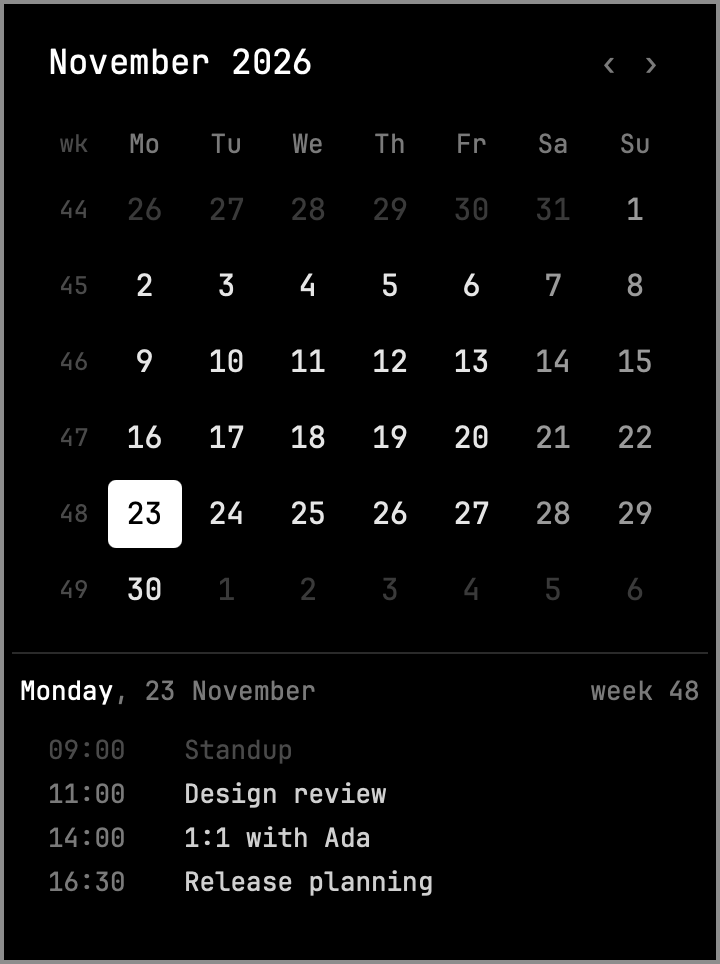

Under the footer are today's events from Calendar.app, so every account added there counts, such as iCloud, Google and Exchange.

- Each event shows its start time, or `all day`. Events already over are dimmed, and the one going on now is white.
- It lists five at most, then `+N more`. When there are more, events already over are left out first. Cancelled events and ones you declined are left out.
- **In the bar,** the meeting item shows the next timed event's start time, as `14:00`, from an hour before it starts. It turns into a white pill 5 minutes before the start and goes away 5 minutes after. All-day events stay out of the bar.
- **Joining:** from 5 minutes before a meeting until it ends, Option+Shift+C or a click on the meeting item opens its Zoom, Google Meet or Teams link. When several meetings can be joined, a card lists them, with the one starting next selected, else the one that started last. With none to join, the calendar card opens. The link comes from the event's URL, else its location, else its notes. Only those links are saved, never the notes themselves.
- Events are read when Hammerspoon starts, every 5 minutes, when the Mac wakes, and when the card opens.
- They're read by a small Swift helper, `agenda.swift`, built the first time into `~/.cache/omv/Agenda.app`. It runs as its own app because macOS asks the app that reads calendars for permission, and Hammerspoon can't ask. The first time, macOS asks to let "omv agenda" access your calendars. If you refuse, the card says so, and you can allow it later in System Settings > Privacy & Security > Calendars.

**World clocks.** Off unless turned on, with `omv flags world-clocks on`. Then list the places you want in `~/.config/omv/clocks`, one per line, as a name and a time zone:

```
# name = time zone
NYC = America/New_York
Delhi = Asia/Kolkata
Tokyo = Asia/Tokyo
```

Under today's events, a Clocks section shows each name with its time there, in 24 hours, and how far it is from yours, as `−8 h` or `+2:30`. When the date there isn't today's, the time starts with its weekday, as `Sat 09:30`. A time zone the Mac doesn't know shows `unknown time zone` instead of a time; the names are the IANA ones, such as `Europe/London`. The file is read each time the card opens, so an edit shows without a reload, in the file's order and eight at most. Without the file, or with no line it can read, there's no Clocks section. The times are worked out in the card itself, with no command run, and move on each minute while the card is open; nothing of them runs while it's closed.

## Your own workspaces

One file, `~/.config/omv/workspaces`, says which workspaces there are, the screens each goes on, the apps that live on it, and each screen's gaps, much as Hyprland's workspace rules do. Option+Escape, then **Workspaces**, edits it, and so does Option+W on a window. You can also edit it in any editor: saving it applies it, without a reload.

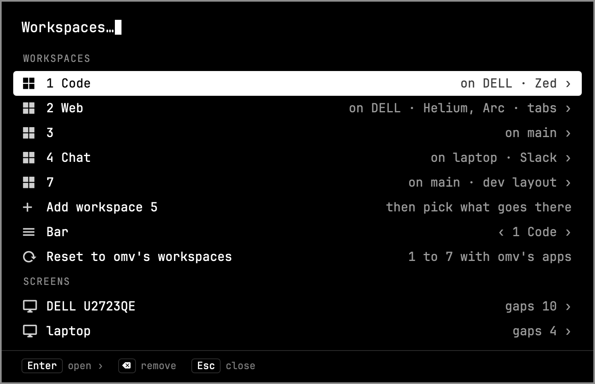

```ini
dev = 7                       # the dev layout's workspace
bar = {number} {name}         # how the bar shows a named workspace

[workspace 1]
name = Code                   # shown in the bar as "1 Code"; without one, just "1"
on   = DELL, laptop           # the screens it goes on, the first plugged in; main is always last
apps = Zed                    # each opens its windows here, ahead of your own rules

[workspace 2]
on     = DELL
apps   = Helium, Arc
layout = tabs                 # tiles or tabs, set as it lands

[workspace 4]
on   = screen 2
apps = Slack
open = Slack                  # started when you go to workspace 4 and it's empty

[workspace 7]

[screen laptop]
gaps = 4                      # or gaps.inner and gaps.outer apart
layout = tabs                 # for its workspaces without their own

[screen DELL]
gaps = 12
```

- **Workspaces:** each `[workspace N]`, 1 to 9, gets Option+N, Option+Shift+N and the numpad's, and a number in the bar. A removed one frees its keys, and its windows move to the lowest workspace left. Without a `[workspace]` section, today's seven apply, with omv's apps from the table above: 1-3 and 7 on main, 4-6 on screen 2. The first change from a card writes them all into the file, apps included, so what you see is everything there is. **Reset to omv's workspaces**, in the card, puts them back, keeping your screens. A line omv can't read keeps today's seven until it's fixed; the notice and `omv doctor` name it.
- **Screens:** `main` is the display with the menu bar; `screen 2`, `screen 3` and so on are the others, counted from the left without the main one, for as many as are plugged in, as arranged in System Settings > Displays; `laptop` is the built-in screen; anything else is part of a display's name, such as `DELL`. `on` lists them in the order to try, so a workspace lands on the first plugged in, and on `main` when none is. `secondary`, AeroSpace's word, means `screen 2`. `omv displays` prints the names of the displays plugged in now and those seen before.
- **Apps:** each app goes on one workspace, by its name or its bundle id, such as `com.apple.Notes`. A bundle id matches whatever language macOS names the app in, so omv's own apps and the cards use them. Saving the file moves the open windows of the apps whose workspace changed; an app taken off a workspace stays where it is and opens new windows on the workspace you're on. An app with windows on more than one workspace is left alone, and a window you move stays. Option+Enter, Option+Shift+N, Option+Shift+Enter and Option+Shift+T open Ghostty, the editor, the browser and btop on the workspace that keeps their app, or on the one you're on.
- **Layouts** are set as a workspace lands on a screen, and only when its layout in the file changed: Option+A still switches it for the moment.
- **Gaps:** `[screen NAME]`'s gaps replace omv's on that screen, after your own `~/.config/omv/aerospace.toml`. The built-in screen keeps its top gap below the notch; on other displays the outer gap is measured below the bar.
- **Names:** `name` gives a workspace a name of up to 16 characters, emoji and Nerd Font icons included, shown in the bar and the cards. A workspace without one shows only its number. `bar` sets how the bar shows a named workspace, with `{number}` and `{name}`: `{number} {name}` gives "1 Code", the default; `{number}: {name}` gives i3's "1: Code"; `{name}` gives "Code" alone. `#` starts a comment, so a name can't have one. The cards set both, too. To restyle the workspace items themselves, set `space.1` to `space.9` in `~/.config/omv/sketchybar.sh`.
- **dev** is the dev layout's workspace; when it isn't one of them, the last is used.

### The Workspaces card

Enter opens a workspace or a screen in a card of its own; Backspace removes a workspace, with **Bring back** in its place for a minute; **Add workspace 5** adds the next, up to 9. Each change is written to the file at once, keeping your comments, and applies a second after the keys stop.

- **Naming:** a workspace's **Name** row opens a box with its name typed in: change it and press Enter, or empty it to have only the number; Backspace on the row removes it too. **Bar**, in the Workspaces card, steps with Left and Right through how the bar shows a name: `1 Code`, `1: Code` or `Code`.
- **A workspace:** **First** and **Then** are its screens in order, Left and Right to change one, Backspace to drop it, and **Then try another** to add one; main is always last. Left and Right change its **Layout**, or leave it to the screen's, and the app to **Open when empty**. **Add an app…** lists the apps open now, with the workspace each lives on, or type a name; Backspace takes one off.
- **A screen:** **All gaps**, **Gaps between windows** and **Gaps at the screen edges**, and its layout. Every display omv has seen is listed, so you can set one that isn't plugged in now.

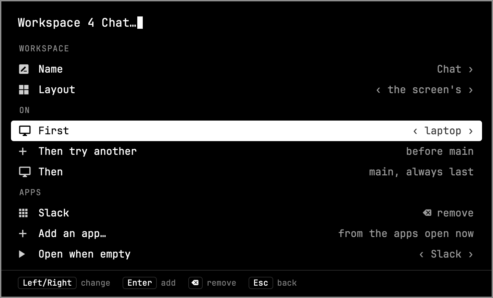

### Option+W

Option+W opens a card for the focused window: **Keep Zed on workspace 1** puts the app on that workspace from now on; **Move to workspace…** moves it and keeps it there; **Move to a new workspace** adds the next one on the same screen and moves it there; **Open Zed when 1 is empty**; **Forget Zed's place** takes it off its workspace, so it opens where you are, or where your own `aerospace.toml` sends it.

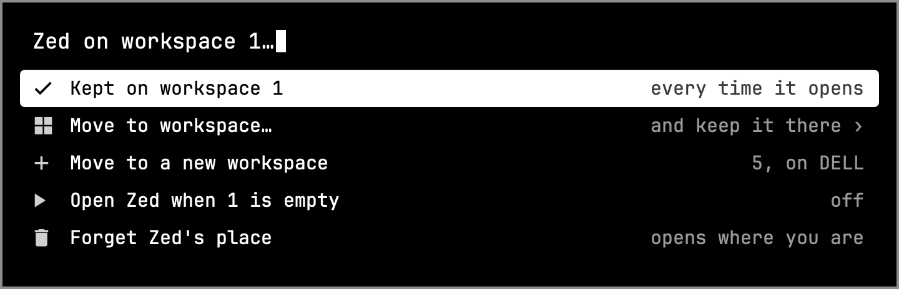

Display profiles, in `~/.config/omv/profiles` or `displays`, are no longer read; `omv doctor` names a file left from them. Their workspaces, apps and gaps go in `[workspace]` and `[screen]`.

## Meeting mode

Off unless turned on, with `omv flags meeting-mode on`, since it pauses your music and hides apps on its own. While a meeting runs:

- **Do Not Disturb** comes on, through the same "omv Do Not Disturb" shortcut as the [system menu's switch](#do-not-disturb). Without the shortcut, the Focus is left alone.
- **Music or Spotify** pauses, if it plays.
- **Agents' notices** wait: a session that starts asking for approval sends no notification. The bar's pill still shows it.
- **The apps on workspaces 5 and 6**, such as Messages, WhatsApp, Discord and Spotify, are hidden, so a shared screen shows none of them.

It starts when you join a meeting with Option+Shift+C or the bar's meeting item, or on its own when a Calendar event with a call link starts. It ends when that event ends. **Meeting mode on or off** in the key list and the palette ends it early, or starts it by hand: until the meeting running now ends, or for an hour.

Leaving undoes only what meeting mode changed. A Focus you had on stays on, a Focus you switched off yourself stays off, a player you started again keeps playing, and an app you had hidden stays hidden. A meeting you left early doesn't start meeting mode again, and one that started more than 5 minutes ago, such as after a reload, doesn't start it on its own.

## Reminders and Pomodoro

Option+Shift+M asks "Remind me…". Type a time, then what to remember, and press Enter.

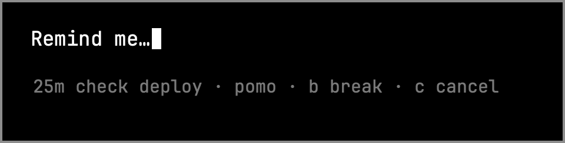

| Type | Does |
|---|---|
| `25m check deploy`, `1h30m stand up` | A reminder. Times use `h`, `m` and `s`, and can be combined |
| `14:30 call`, `9:05 tea` | A reminder at that time, today, or tomorrow when it has already passed |
| `r 25m check deploy` | The same, with an optional `r` |
| `pomo`, `pomo write tests` | 25 minutes of focus, optionally named |
| `b`, `break` | A 5-minute break, straight away |
| `c` | Cancels the soonest reminder |

- The bar shows the time left on the soonest reminder, with a target icon during a pomo and a coffee cup during a break.
- When a plain reminder is due, you get a notification and an alert, and the bar item turns into a white pill with the start of its text, plus `+N` when several are due. It stays until you deal with it: click it for a large card with **Dismiss** (Enter), **Snooze 5 minutes** (`s`) and **Snooze 15 minutes** (`l`). Escape closes the card and leaves the reminder due.
- With nothing due, click the bar item to list your reminders, and press Enter on one to cancel it.

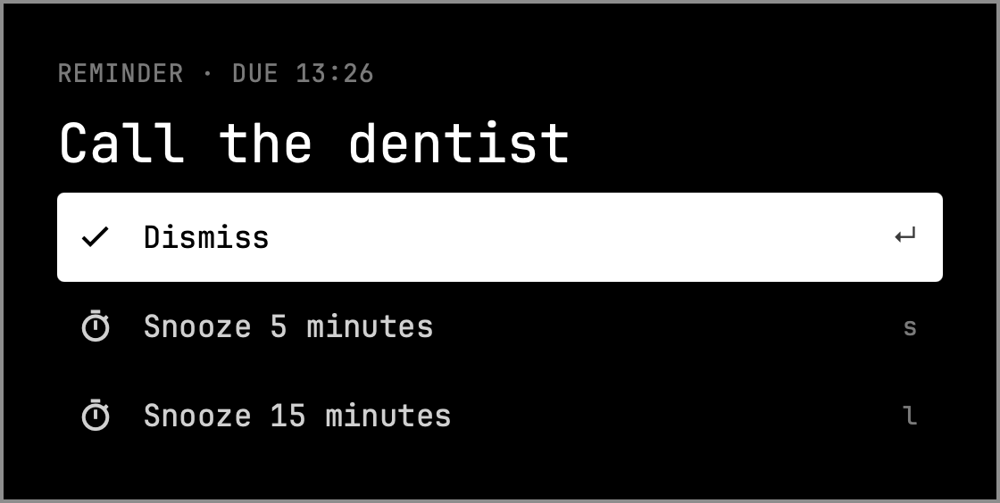
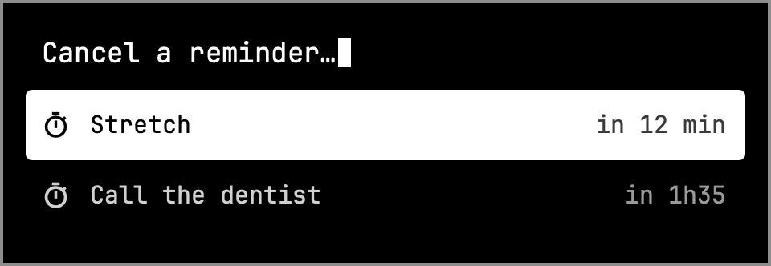
- Reminders are saved in `~/.local/state/omv/reminders`, so they survive a Hammerspoon reload, due ones included. One whose time passed while Hammerspoon wasn't running comes back due, marked late on its card (`LATE · WAS 14:05`), with a "Missed reminder" notification. A Pomodoro or break that passed then is dropped, since its moment is gone.

**Pomodoro.** When a pomo's time is up, the screen dims and a large card takes over. Nothing after it starts on its own: you pick each step.

1. **Time for a break.** The task and today's count, as `2 OF 4 TODAY` with dots. `b` starts the break, which is 15 minutes after every 4th pomo and 5 minutes otherwise, `r` gives 5 more minutes (once per pomo), and `c` skips the break.
2. **Break.** A large countdown, a progress line and a tip that changes each break. The bar shows a coffee cup with the time left. `c` ends it early.
3. **Back to work?** Enter starts the next pomo with the same task, and `c` stops for now.

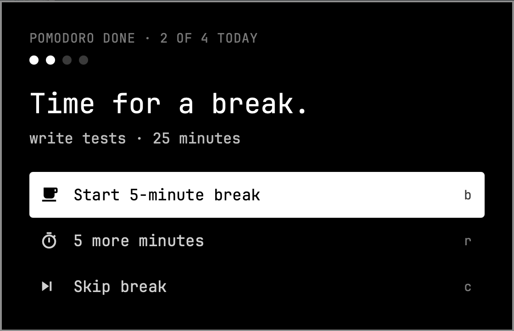
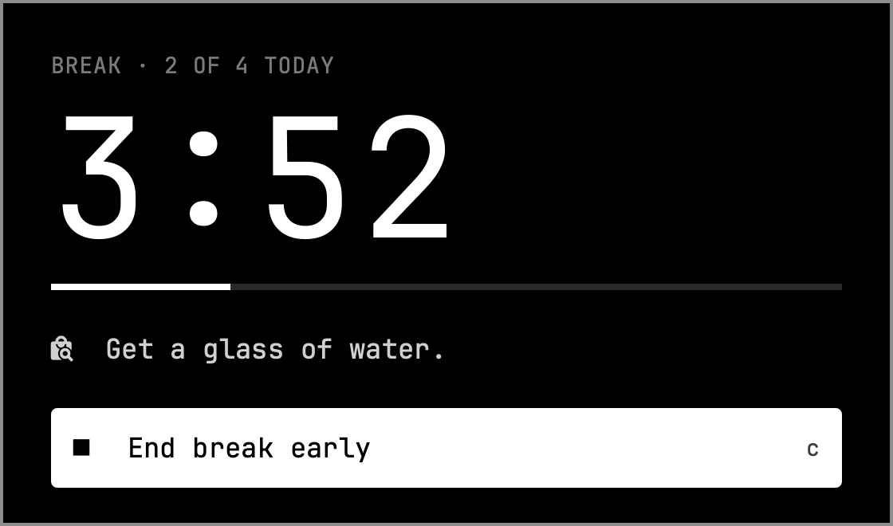
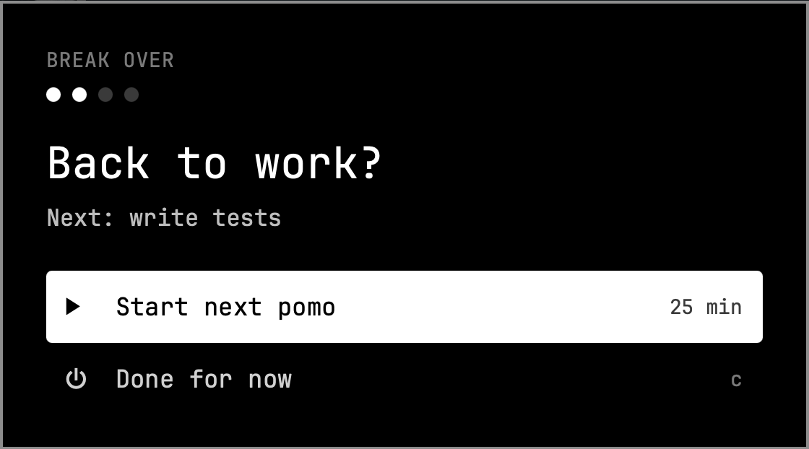

- In a pomo's last 30 seconds, the bar's target item turns into a white pill, so the card never comes as a surprise.
- Escape does the same as `c` on each card.
- The cards stay open when focus moves away, since the break is the point. During a break, clicking the bar item reopens the countdown.
- A break survives a Hammerspoon reload: the bar keeps counting down, and "Back to work?" opens when it ends.
- Today's count is kept in `~/.local/state/omv/pomo` and starts over each day.

## Disk

Option+Shift+X, or a click on the bar's disk item, opens the Disk card. The bar item stays hidden while there's room, and shows the free space once it drops under 20 GB, or under 10% of a larger disk. It's checked with `df` every 10 minutes.

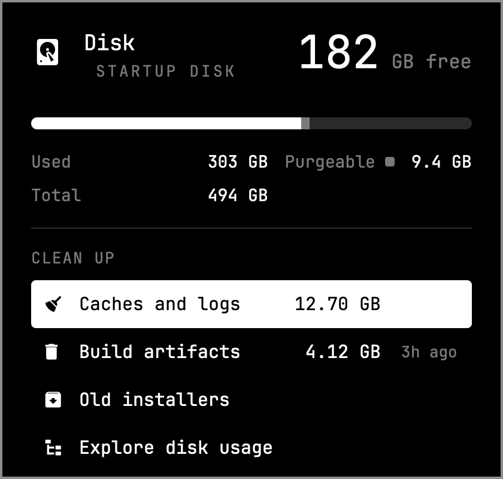

- **At the top,** the free space, then a bar like the one in System Settings > General > Storage: used space in white, purgeable space in gray, free space dark. Under it, used, purgeable and total space. Purgeable space is what macOS frees by itself when it needs room. It comes from `mo status --json` about a second after the first open, it's left out of the free space as Finder and `df` do, and it's no part of the cleanups' sizes.
- **Under CLEAN UP,** the cleanups, one a line. Up and Down move between them, Enter runs one, and Escape closes.
- **Caches and logs** opens `mo clean` in a new Ghostty window. **Build artifacts** opens `mo purge`, **Old installers** opens `mo installer`, and **Explore disk usage** opens `mo analyze`. Each one is [Mole](https://github.com/tw93/Mole)'s own command, and the window stays open when it finishes, so you can read what it removed, skipped or failed on; Enter closes it. The card itself never deletes anything, and never runs Mole with `--yes`.
- **Caches and logs deletes without asking.** `mo clean` removes everything on its list at once; it stops only for system caches, which need sudo (Enter asks for your password, Space skips them). Paths in `~/.config/mole/whitelist` are kept, and `mo clean --whitelist` edits that list. **Build artifacts** and **Old installers** let you pick what goes first.
- **A cleanup can free less than its size.** The size is Mole's dry run, which counts files the real cleanup then can't remove, such as caches owned by root after a `sudo npm install`. Mole's window lists them as failed with `permission denied`, and `mo history` shows what each run actually freed. `sudo chown -R "$USER"` on those folders lets the next cleanup remove them.
- **Sizes beside the cleanups** come from `mo clean --dry-run` and `mo purge --dry-run`. They take up to two minutes, so they run in the background when the card opens, at most once every 6 hours, and the open card updates when they finish. Until then the line shows `measuring…`. A size an hour old or more shows its age beside it, such as `3h ago`. The last sizes are kept in `~/.local/state/omv/disk-clean` and `disk-purge`.
- **The Trash and protected app caches need Full Disk Access.** Hammerspoon measures the sizes, so its Full Disk Access, which omv Setup asks for, lets them count those. The cleanup itself runs in Ghostty, and without Full Disk Access for Ghostty, Mole skips them. omv doesn't ask for that: it would let everything you run in Ghostty, coding agents included, read your Mail, Messages and other apps' data. To clean them anyway, grant it in System Settings > Privacy & Security > Full Disk Access, or run `mo clean` from a terminal that already has it.
- `mo clean --dry-run` also writes its full list to `~/.config/mole/clean-list.txt`. System caches need sudo, so the background preview leaves them out; `mo clean` may ask for your password to clean them.
- `mo purge` scans `~/workspace`, `~/.claude/worktrees` and `~/.codex/worktrees` among others; `mo purge --paths` changes them.
- Without Mole, the card offers `brew install mole`. `omv install` installs it from the Brewfile.

## Lyrics

Right-click the playing track in the bar to open the lyrics in a window of their own; right-click again to close it. Like Ghostty's, the window has no title bar or buttons, only rounded corners. AeroSpace tiles it on the current workspace beside whatever else is there, such as a workout video, and it stays open when focus moves away.

It is made to be read at a glance from across the room, in omv's own look:

- **Line progress:** a bar in the cover's color fills under the line being sung until the next one starts.
- **Lines:** the line being sung is large, a third of the way down. The next one is dimmer, so you can sing ahead, and older lines fade.
- **One color from the cover:** its most vibrant color, moved toward the theme's text color until it reads on the theme's background. A grayscale cover gets the theme's accent instead. It colors the progress bars, the break countdown and a soft glow behind the cover.
- **Theme:** the window takes the [theme's](#themes) colours, and redraws at once when you pick another.
- **Breaks:** before the first line and in instrumental breaks, four squares light up one by one, the last just before singing starts.
- **Cover and track:** a narrow tile shows a small cover above the words, with the title and artist in JetBrains Mono, a progress bar and the time left. A wide window puts a large cover beside them.
- **Paused:** the lyrics dim, the title shows `❚❚`, and everything stops. With Reduce Motion on in System Settings, nothing animates.

How it works:

- It follows Music or Spotify, whichever plays: it counts the position on between reads, and reads the player again every 5 seconds and on every track change, pause or seek.
- Songs with only plain lyrics scroll slowly with the song, still through the intro and outro; scroll by hand and it waits 10 seconds before following again. Instrumentals and unknown songs say so.
- Lyrics come from [LRCLIB](https://lrclib.net), which is sent the track's artist, title, album and length. When that finds nothing, for example for a remaster or a live version, LRCLIB's search is sent the artist and the title without extras such as `(feat. …)` or `- Remastered`. Only an answer by the same artist, with the same title and at most 2 seconds off in length is used, and the window then says `found by search`. The cover comes from the player, or else from Apple's iTunes Search, which is sent the artist and album. Each song's lyrics and cover are fetched once, then read from `~/.local/state/omv/lyrics/`.
- The window is a small helper app, built with `swiftc` into `~/.cache/omv/Lyrics.app` the first time it opens, so that first open takes a few seconds. While a song plays, it uses about 2% CPU: the background is drawn once and never moves.

## Volume and brightness

The volume, mute and brightness keys show omv's own pop-up instead of macOS's: an icon and 16 segments in a card, in the theme's colours, at the bottom of the display the pointer is on.

- **Volume** moves in macOS's 16 steps on the current output. An output macOS can't set the volume of, such as some HDMI displays, keeps macOS's own behavior.
- **Fine steps:** hold Option with a volume or brightness key to move 1% at a time.
- **Brightness** dims the display under the pointer: the built-in one directly, an external one over DDC with [m1ddc](https://github.com/waydabber/m1ddc). A held key changes the pop-up at once and the display once it settles, since DDC is slow. The first press after a pause reads the display first, so it starts from the level the display's own buttons left. A display that doesn't answer DDC keeps macOS's behavior.
- Catching the keys needs Accessibility for Hammerspoon, in System Settings > Privacy & Security > Accessibility. Without it, the keys work as macOS's own.

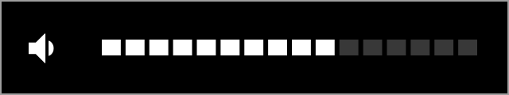
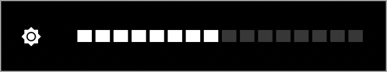

## Night light

Option+Shift+Z, or Option+Escape, then **Night light**, switches macOS's Night Shift on or off. While it's on, the bar shows a moon; click it to turn night light off. Night Shift's own schedule still applies, and the bar checks again every 5 minutes, so it follows a scheduled change too. macOS has no public way to switch Night Shift, so omv uses [nightlight](https://github.com/smudge/nightlight), which `omv install` installs.

## Input source

Off until `omv flags input-source on`. Then the bar shows the keyboard input source in use as a short tag, such as `TR` for Turkish Q or `US` for U.S. and ABC, left of the Wi-Fi. Click it to switch to the next enabled source, wrapping around to the first. With only one source enabled in System Settings, there is nothing to switch, so it stays hidden.

A layout omv doesn't know is tagged by the first two letters of its name, so Polish shows `PO`. Input methods, such as Japanese, are listed after the layouts and tagged the same way. macOS announces every change, from the item, the menu bar or Ctrl+Space, so nothing is polled, and the bar is redrawn only when the tag changes.

## Camera and mic in use

Off until `omv flags in-use on`. Then the bar shows a green camera while any camera is in use, and an orange mic while any audio input is running, beside the red muted mic, so it's there with the menu bar hidden too. Nothing shows otherwise, and a click on either does nothing.

- **Event-driven:** each camera and input device tells Hammerspoon when its use changes, and cameras or mics plugged in later are watched too. There's no timer and no helper, and the bar is only sent a dot that changed.
- **omv's own mic:** the Sound card's level meter and [dictation](#dictation) don't light the mic dot. While either listens, and for 1.5 seconds after, mic use is ignored, including another app's.
- **No permission:** it only reads whether a device is in use, never the picture or sound, so macOS asks for nothing.
- **Any use counts:** a device that's both a mic and speakers, such as a USB headset or dock, can light the mic dot while it only plays sound, and so can a virtual device an app keeps running.

## Dev layout

Option+Space, then **Dev layout**, lists your recent Claude Code projects, the most recent first. Pick one, then:

- **Open project:** your editor on the project on the left half of the dev workspace, 7, on the main monitor, and Claude Code above a shell, both in the project, on the right. When the editor already has the project open, that window comes over instead of a new one.
- **New task in a worktree:** the same layout on a new git branch, `task-YYYYMMDD-HHMM`, in a folder of its own under `~/.local/share/omv/worktrees/<project>/`, so the task can't collide with other work in the repo and the repo's `git status` stays clean. The editor opens it in a new window. Offered only for a git repository.

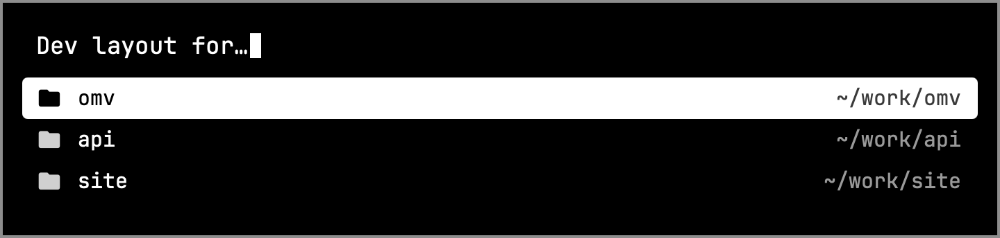

Option+Space, then **Agent grid**, starts 2, 3 or 4 Claude Code sessions on a project, each on its own branch and worktree, as panes of one tmux session, `omv-<project>`, in a window on the dev workspace: side by side, or two over two for four. The mouse scrolls each pane.

- Closing the window leaves the agents running. The project then shows `running` in the list; pick it to **Reattach**, or to **End all agents**, which asks first and keeps the worktrees. `tmux attach -t omv-<project>` reattaches from any terminal too.
- When an agent in the grid waits for you, the bar's pill and Option+Shift+A go to its pane.

- No app is ever sent to workspace 7, so a layout has the screen to itself. Starting another sends what was there back to its usual workspace, Ghostty to 1 and the editor to 2, so nothing still running is closed.
- A new worktree is a folder neither the editor nor Claude Code has seen, so both ask once whether to trust it. Zed can trust everything under `~/.local/share/omv/worktrees` with its checkbox.
- Worktrees stay until you remove them, since they may hold work: `git worktree remove <folder>`, then `git branch -d <task>` once it's merged.

## Share with AirDrop

Option+Shift+Q opens macOS's AirDrop sheet for the files selected in Finder. With nothing selected, it shares a file you copied, or else an image you copied, saved as a PNG. The first time, macOS asks to let Hammerspoon read Finder's selection. AirDrop needs Wi-Fi and Bluetooth on; the sheet says when they're off. A small Swift helper, `share.swift`, is built with `swiftc` the first time and kept in `~/.cache/omv/share`.

## Translate

Select text anywhere and press Option+Y. omv finds its language on the Mac and translates it into the first of your Mac's languages, in System Settings → General → Language & Region, that it isn't in already, else into English. With English then Turkish there, Turkish text becomes English and English text becomes Turkish.

The first time, a card asks which service translates. The choice is kept, and the card's Another service (Cmd+K) changes it:

| Service | Where | Setup |
|---|---|---|
| Apple (recommended) | On the Mac: nothing is sent anywhere, and it works offline | Each language is downloaded once. The card offers to, macOS's own sheet downloads it, and the selection is then translated. Languages are also managed in System Settings → General → Language & Region → Translation Languages. |
| DeepL | Online: the selected text goes to DeepL | A key: the free plan covers 500,000 characters a month. The card opens DeepL's page; copy the key, then pick Use the copied key. It's kept in the macOS Keychain, never in a file. |
| Claude | Online: the selected text goes to Claude, through Claude Code's `claude -p` on Sonnet | Claude Code installed and signed in; it counts towards your plan. It keeps tone and formatting, and takes a few seconds. |

The result card shows the service, your selection and its translation. Enter pastes the translation over the selection, Copy (Cmd+C) puts it on the clipboard, Translate back (Cmd+B) checks it by translating it back, and Another language (Cmd+L) lists the languages, those on the Mac first for Apple. The language you pick is kept for the next translations; pick Automatic to go back. Copying the selection leaves your clipboard as it was; Replace and Copy put the translation on it.

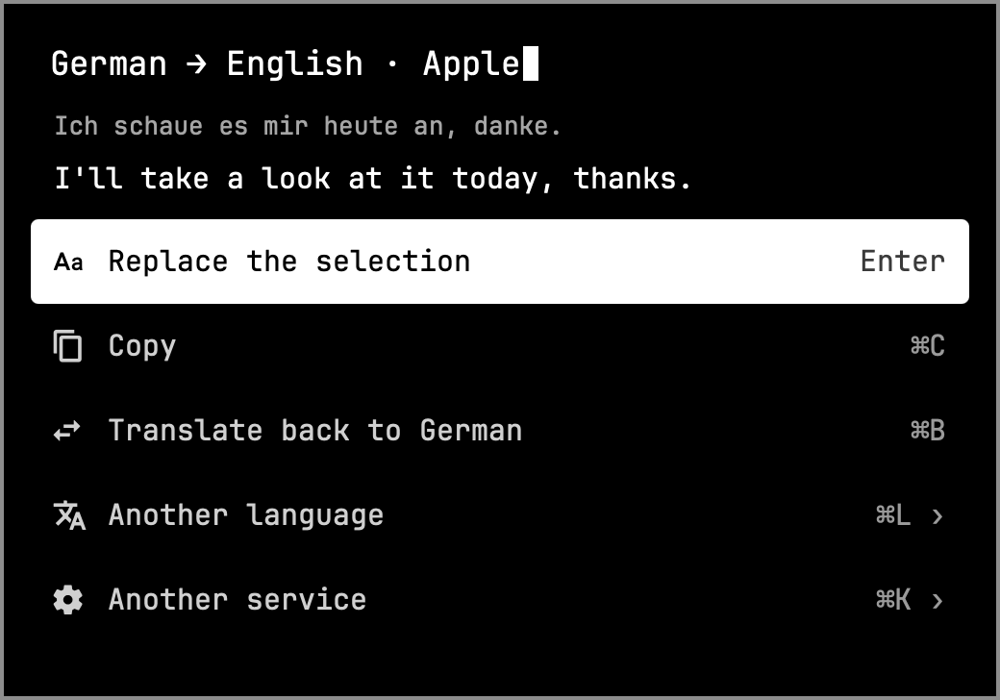

Copying the selection and pasting need Accessibility for Hammerspoon. A small Swift helper, `translate.swift`, finds the language and runs Apple's translation; it's built with `swiftc` the first time and kept in `~/.cache/omv/translate`.

## Dictation

Off until `omv flags dictation on`. Then hold **Right Option** alone and talk: a pill at the bottom of the screen says Starting until the mic is open, a fraction of a second, then Listening with the start sound, and shows the words as they're heard, and releasing the key types them where you were typing, in any app; release it with **Shift** held to only copy them. For a long one, tap Right Option twice: it listens hands-free, and one more tap types it, Shift copies it, and after 30 seconds without speech it types by itself, counting down the last 10. Esc cancels. Everything is heard on the Mac, with macOS's own speech models: nothing is sent anywhere, and there's no account.

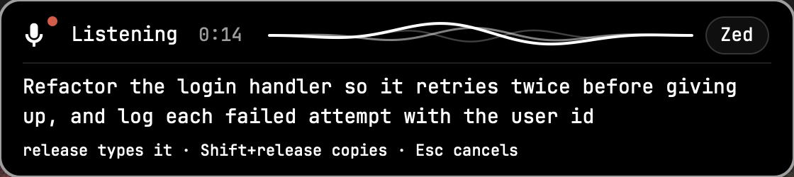

- **The key:** omv's keys all use Left Option, so Right Option alone is free. Recording starts at the press, so the first word isn't cut off, and the pill shows once the key has been held alone for 0.3 seconds. Another key in that moment cancels it, so Right Option still types @, € and the rest on keyboards that use it.
- **The pill:** its header shows the state and its time, a meter of your voice, and the app the words go to, which follows the app you're in; a password field turns it orange. While locked, the meter turns into the countdown: orange dots going out from the right.
- **Typing it:** the text is pasted into the app you're in when it ends, and your clipboard is put back once the app has read it; the paste is kept out of the clipboard history. The pill says how many words were typed; ⌘Z undoes it. With no window to type in, a password field, or Shift, it's only copied. A locked one that ends by itself only types into the app it started in; if you moved to another, it's copied instead, and the pill says so. **Paste last dictation**, in the palette, types the last one again, and the card's **Dictations** lists the last 10, with their app and time, to paste any of them. They're kept in `~/.local/state/omv/dictations`, readable only by you, so they outlive a reload; delete the file to forget them.
- **Your words and ums:** names and terms it should hear right, such as `words = omv, AeroSpace, Ghostty` in `~/.config/omv/dictation`, which the card's **Your words** opens; only the dictation model takes them, so they help the languages it hears, Turkish among them. Filler sounds, um, uh, ıı and the like, are dropped, never words; the card, or `cleanup = off`, keeps them.
- **Spoken replacements:** a `replace = slash voice > /voice` line in `~/.config/omv/dictation` types `/voice` whenever you say "slash voice", one rule a line; `\n` in the replacement is a line break. A phrase matches as whole words, in any case; the pill shows the replaced text as you speak.
- **Two languages:** with `languages = tr-TR, en-US`, Tab while the pill shows moves to the next one, named in the pill's hint, with its code beside the app. The words so far stay; listening restarts in the new language, which takes about half a second, while the pill says Starting.
- **Language:** macOS's own language, in System Settings → General → Language & Region, unless the Dictation card, in the System menu, picks another; it's kept as `language = tr-TR` in `~/.config/omv/dictation`. Each language's model is downloaded once, the first time it's used or picked, with its progress in the pill. Dozens of languages work; English, German, French, Spanish, Italian, Portuguese, Japanese, Korean and Chinese use macOS's newer transcriber, which hears quiet speech from the start and punctuates a long dictation throughout, and the rest, Turkish among them, its dictation model.
- **Sounds:** a short ping as it starts and a tick as it ends; the card, or `sounds = off`, turns them off.

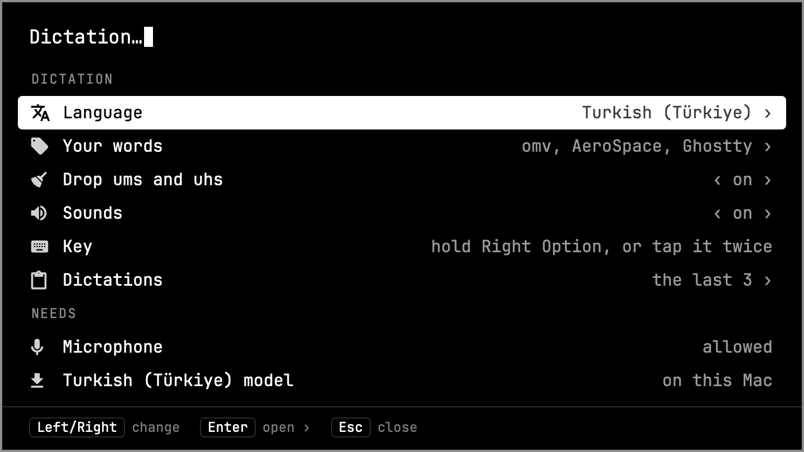

### Voice to agents

Off until `omv flags voice-agents on`, with `dictation`, `claude` and `send-to-agent` on too. Hold **Right Command** alone and say **tell omv run the tests and fix what fails**: on release, "run the tests and fix what fails" lands in the prompt of the Claude Code session in the `omv` folder, and its terminal comes forward. Enter is never pressed, so you read it and send it yourself, as with Option+P. **reply looks good, commit it** goes to the session that finished last.

- **The key:** the mic opens only once Right Command has been held alone for 0.3 seconds, so Cmd shortcuts never touch it; start talking at the start sound. Another key or a click while it's held cancels it and goes through, so Cmd+C, Cmd+Tab and Cmd+click work as always. Esc cancels.
- **The project:** said as its folder is named, in any case; `omv-web` is "omv web", and a name spelled out, "o m v", counts too. A name of five letters or more may be heard one letter off. The folder names are given to the speech model, so they're heard as written. Two sessions in folders of the same name aren't guessed between: the pill names both and nothing is sent.
- **By number:** while you hold the key, the pill lists the sessions, numbered: 1 is the one **reply** goes to, then the others that finished, newest first, then those asking or working. **one run the tests** goes to session 1, as does "number one …"; numbers are heard far more reliably than project names. When nothing you said names a session, the pill stays a moment after you let go, shows what was heard, and asks which one: a digit 1 to 9 sends the words there, and Esc, any other key or 5 seconds copy them instead, so nothing is lost.
- **The pill:** says Command, and names the session the words go to, with its state, as you speak. Only a session that finished and waits takes the words: one that's working would be interrupted, and one asking for approval would take them as its answer, so for those they're copied instead.

### Talk back

Off until `omv flags talk-back on`, with `claude` on too. When a Claude Code session finishes, the start of its last message, up to 20 words, is spoken in your headphones, and a pill shows it as it's spoken: "omv finished: Tests pass. I changed dictation.lua." Code, links and paths are left out or shortened; Turkish text gets a Turkish voice when the Mac has one. Several finishes are spoken one after another.

- **When:** only into headphones, never to the room; not while meeting mode holds notices, not while you dictate, and not for the terminal you're looking at. Otherwise the bar's robot shows the finish, as always.
- **Answering:** pressing Right Option or Right Command stops it at once. With `voice-agents` on, holding Right Command and saying **reply …** answers the session that just spoke, for two minutes after.
- **What's kept:** with the flag on, the Claude Code hook keeps the first 600 bytes of Claude's last message beside the session's state in `~/.local/state/omv/claude-sessions`, readable only by you, until the next prompt or the session's end. With it off, nothing is kept. Speech is macOS's own; nothing is sent anywhere.

It needs the microphone, asked for the first time, and Accessibility to paste. A small Swift helper, `dictate.swift`, hears the speech with macOS 26's SpeechAnalyzer; it's built with `swiftc` the first time and kept in `~/.cache/omv/dictate`.

## Do Not Disturb

While a Focus such as Do Not Disturb is on, the bar shows a moon and its name. Option+Escape, then **Do Not Disturb**, or a click on the moon, switches Do Not Disturb.

- The bar reads macOS's own Focus files, which needs Full Disk Access for Hammerspoon, in System Settings > Privacy & Security > Full Disk Access. A Focus on a schedule isn't in those files, so it doesn't show.
- macOS lets nothing but Shortcuts switch a Focus, so omv runs a shortcut named `omv Do Not Disturb`. Make it once in Shortcuts, with the single action **Set Focus**: Do Not Disturb, Toggle. Until it exists, the menu says so and opens Shortcuts.

## Tailscale

Once [Tailscale](https://tailscale.com) is installed, the bar shows its icon, white while connected. Click it for a card: **Connect** or **Disconnect**, then each of your devices with its Tailscale address, online ones first; Enter copies a device's address. While Tailscale needs a login, the first row opens the Tailscale app. omv reads Tailscale's state with its own CLI every 30 seconds, and doesn't install it.

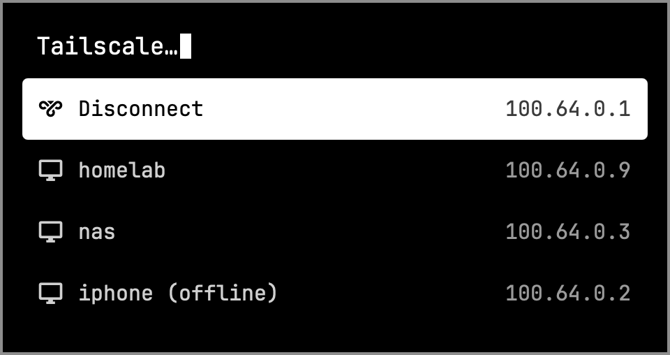

## Capture menu

Option+Shift+S opens a card for screen captures.

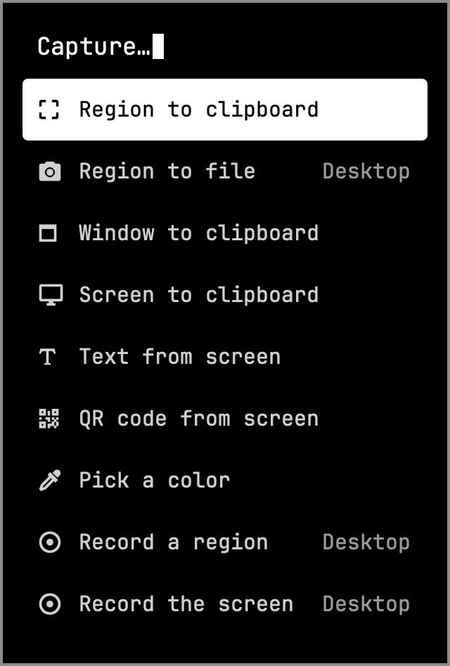

| Item | Does |
|---|---|
| Region to clipboard | Select an area, copy it as a picture |
| Region to file | Select an area, save it to the Desktop, named like macOS's own screenshots |
| Window to clipboard | Click a window, copy it |
| Screen to clipboard | Copy the whole screen |
| Text from screen | Select an area, copy the text in it, read by macOS's Vision framework |
| QR code from screen | Select an area, copy what the QR code in it says |
| Pick a color | Click anywhere, copy its color as `#RRGGBB` |
| Record a region | Drag an area, then record it to the Desktop, named like macOS's own recordings |
| Record the screen | Record the whole display the pointer is on to the Desktop |

While a recording runs, the bar shows `rec`; click it, or press Option+Shift+S again, to stop and save it. Recordings show clicks, and have no sound.

- The first capture asks you to give Hammerspoon Screen Recording, in System Settings > Privacy & Security > Screen & System Audio Recording. Every item except Pick a color needs it.
- Text, QR codes, color and the region to record use a small Swift helper, `capture.swift`, built with `swiftc` the first time and kept in `~/.cache/omv/capture`.

## Smaller tools

- **Keep awake (Option+Shift+I):** runs `caffeinate -di`, keeping the display and system awake during long builds or Claude Code runs. Press the key again or click the icon to stop. It stays on when the bar restarts and turns off at reboot. Only the `caffeinate` it started is checked or stopped, through its process ID in `~/.local/state/omv/keep-awake.pid`. Closing the lid on battery still puts the Mac to sleep, and the key does nothing while SketchyBar isn't running.
- **Copy URL (Option+Shift+U):** copies Helium's current URL. The first time, macOS asks to let Hammerspoon control Helium.
- **Quick note (Option+Shift+D):** a card that grows as you type, with Markdown marks shown dimmed. Enter carries a list on, Tab indents it, and Cmd+Enter saves. One line lands as `- 09:05 call the bank` at the end of today's daily note in `~/Documents/vault/work/00 - Daily/`. Several lines land as a block under `### 09:05`. A note that starts with `# Title` becomes its own page in `~/Documents/vault/work/Inbox/`, numbered when the name is taken, and the daily note gets `- 09:05 [[Title]]`. Escape on an empty card closes it. With text, the first Escape asks: a second Escape keeps the draft for next time, Cmd+Backspace throws it away. The draft is kept in `~/.local/state/omv/note-draft` until you save or discard it, so it survives a Hammerspoon reload. Cmd+O lists the notes in both folders, today's first, then newest first. Enter opens one in the same card to read or edit, and Cmd+Enter saves it, unless it changed in Obsidian since you opened it. Escape goes back a step, first asking when edits would be lost. Listing the folders needs Hammerspoon to have access to Documents. The vault is `~/Documents/vault/work` unless `~/.config/omv/vault` names another on its first line, such as `~/Notes/work`; it's read each time, so a change needs no reload. Every note is written to a temporary file beside it, then put in place, so a failed write never leaves a note cut short. A day without a note gets a plain file, not your template, because Obsidian only applies templates to notes it creates itself.

  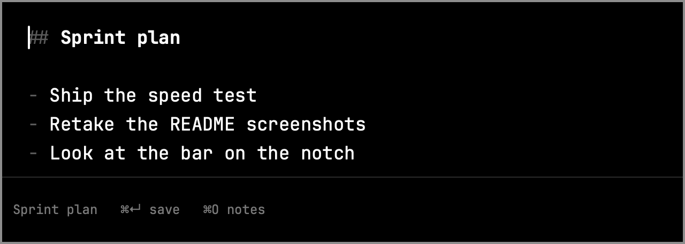

  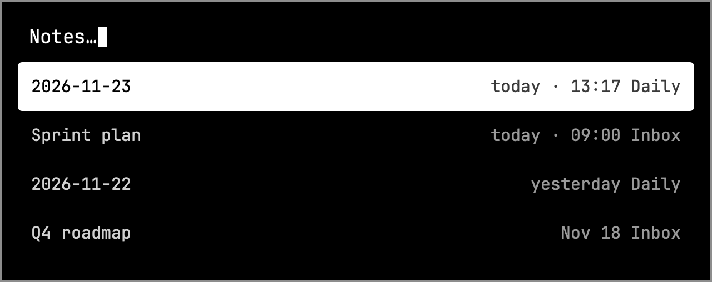

- **Hungry processes (Option+Shift+P):** your 20 busiest processes by CPU, by memory after Tab, or your listening TCP ports after a second Tab, as `:3000  node  ~/workspace/app`, each with the folder it runs in, so a dev server or build an agent left behind is easy to spot. Type to filter, and Enter asks, then quits it. A process still running 3 seconds later is offered Force quit. Only your own processes are listed, never `loginwindow`, `launchd` or Hammerspoon.

  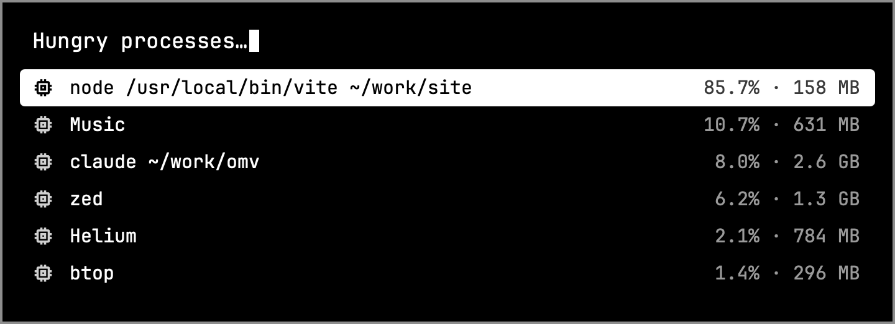
- **System load in the bar:** off unless turned on with `omv flags system-load on`. The bar then shows `CPU 92%` while all processes together use over 80% of every core, `mem high` or `mem critical` while macOS reports memory pressure, or both, as `CPU 92%, mem high`. It stays hidden the rest of the time, and when `ps` or `sysctl` fails. It's checked every 10 seconds with one `ps` and one `sysctl`, and the bar is only touched when the text changes. A click opens hungry processes, which needs the `processes` flag on.
- **Clipboard history (Option+V):** the text you copied in the last day, at most 50, and the last 20 images, newest first; an image shows as a small preview with its size. Type to filter, and Enter pastes it where you were typing, as [snippets](#snippets) do, and leaves it on the clipboard. Without Accessibility for Hammerspoon, it's only copied, for you to paste with Cmd+V. It's kept in memory only, so a reload forgets it. Secrets are never kept: copies password managers mark as concealed, copies made while 1Password, Bitwarden, Passwords or Keychain Access is in front, and text shaped like a key or token (`sk-…`, `ghp_…`, `AKIA…`, a JWT, a private key, or a `KEY=`, `TOKEN=`, `SECRET=` or `PASSWORD=` line). Text and images are kept, never files. **Pause history** and **Clear history** are the card's first rows; while paused, the bar shows `paused`, and a click on it turns history back on. A secret with no recognizable shape is still kept, so pause the history for sensitive work.

  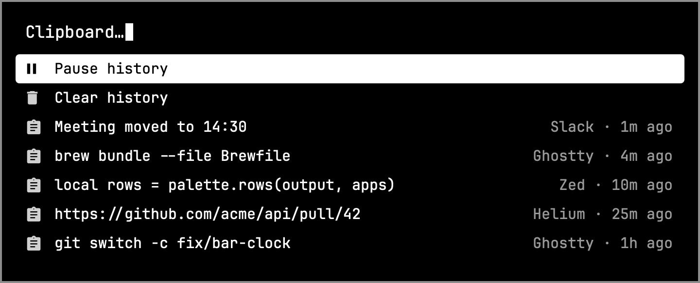
- **Outdated packages:** with `omv flags brew-outdated on`, the bar shows how many Homebrew packages `brew outdated` lists, and hides at 0 or when `brew` is missing. A count that fails, such as one asked while an upgrade is finishing, is asked again 30 seconds later, and a second failure leaves the item as it was. It counts every 6 hours and when the Mac wakes, but a wake less than an hour after the last count keeps that one; the time of the last count is kept in `~/.local/state/omv/brew-outdated`. The count runs with `HOMEBREW_NO_AUTO_UPDATE=1`, so it never runs `brew update` or reaches the network: it's only as fresh as your last `brew update` or `brew upgrade`. A click opens `brew upgrade` in a new Ghostty window, which does update Homebrew first; the item counts again as soon as the upgrade ends, and the window stays open until Enter so you can read what changed.
- **Drop-down terminal (Option+\`):** Ghostty's quick terminal, over any workspace.
- **Long commands:** in Ghostty, a command that runs longer than 10 seconds sends a notification when it finishes while you're in another window. The first one makes macOS ask to allow notifications from Ghostty.
- **Scripting:** each card opens with `hs -c`: `omvToggleSystemMenu()`, `omvToggleSound()`, `omvToggleWifi()`, `omvToggleBluetooth()`, `omvToggleEthernet()`, `omvToggleWeather()`, `omvToggleBattery()`, `omvToggleAgents()`, `omvToggleKeyList()`, `omvToggleCalendar()`, `omvJoinMeeting()`, `omvToggleMeetingMode()`, `omvToggleWindows()`, `omvTogglePrs()`, `omvToggleCi()`, `omvToggleClipboard()`, `omvToggleProcesses()`, `omvToggleDisk()`, `omvBrewUpgrade()`, `omvFocusClaude()`, `omvSendToAgent()`, `omvToggleCapture()`, `omvStopRecording()`, `omvToggleFocus()`, `omvWorkspaces()`, `omvWindowCard()`, `omvToggleTailscale()`, `omvToggleMic()`, `omvNewReminder()` and `omvToggleReminders()`.

## Feature flags

Every feature below can be turned off, and turned back on, with one command:

```sh
omv flags                  # every flag and whether it's on
omv flags weather off      # turns the weather off, then reloads
omv flags weather on
```

That writes `weather=off` to `~/.config/omv/flags`, then reloads Hammerspoon and the bar. A feature that's off isn't loaded at all: its key is free for your own bindings, its card, bar item and palette entries are gone, and nothing of it runs in the background. The desktop itself has no flags: tiling and workspaces, the palette, the key list, the system menu, themes and the clock. Every flag is on unless the table says otherwise. The two Ghostty flags apply on Ghostty's reload key, Cmd+Shift+Comma.

| Flag | Turns off |
|---|---|
| `weather` | the temperature in the bar and the forecast card (Option+Shift+O) |
| `battery` | the battery item and card (Option+Shift+B) |
| `bluetooth` | the Bluetooth item and card (Option+Shift+Y) |
| `network` | the Wi-Fi and Ethernet items and cards (Option+Shift+W, Option+Shift+E) |
| `sound` | the volume item, the Sound card (Option+Shift+V), its row in the system menu, and Option+O |
| `calendar` | the calendar on a click of the clock, the next meeting in the bar, and Option+Shift+C |
| `disk` | the low-disk item and the Disk card (Option+Shift+X) |
| `tailscale` | the Tailscale item and card |
| `focus` | the Do Not Disturb item and its row in the system menu |
| `clipboard` | clipboard history (Option+V) and its `paused` item |
| `snippets` | your snippets in the palette |
| `calculator` | sums and conversions in the palette |
| `clipboard-actions` | the palette's clipboard row: pretty JSON, a JWT decoded, base64, URL escapes and epoch times |
| `translate` | translating the selection (Option+Y) |
| `capture` | the capture menu (Option+Shift+S) and the recording item |
| `reminders` | reminders and Pomodoro (Option+Shift+M) and their item |
| `daily-note` | the quick note (Option+Shift+D) |
| `airdrop` | sharing with AirDrop (Option+Shift+Q) |
| `copy-url` | copying the browser's URL (Option+Shift+U) |
| `keep-awake` | keeping the Mac awake (Option+Shift+I) and its item |
| `night-light` | night light (Option+Shift+Z), its item and its row in the system menu |
| `mic-mute` | muting the mic (Option+M) and its item |
| `window-sizing` | halves, thirds, almost full and centred for the focused window (Ctrl+Option+arrows, Ctrl+Option+C) |
| `volume-popups` | omv's volume and brightness pop-ups, and dimming an external display; macOS's own come back |
| `processes` | hungry processes and ports (Option+Shift+P) |
| `lyrics` | the lyrics window |
| `now-playing` | the playing track in the bar |
| `claude` | Claude Code's usage, the waiting pill, the Agents card and Option+Shift+A |
| `send-to-agent` | sending the selection, the clipboard or a screenshot to an agent (Option+P); it needs `claude` on too |
| `away-digest` | opening the agents' inbox on unlock after a break, and its While away section; it needs `claude` on too |
| `github-prs` | pull requests waiting for your review (Option+Shift+G) and their item |
| `github-ci` | the checks on your own open pull requests, their item and the notice when a failing one passes |
| `dev-layout` | the dev layout and the agent grid |
| `drop-down-terminal` | Ghostty's quick terminal (Option+\`) |
| `long-command-notices` | Ghostty's notice when a long command finishes |
| `meeting-mode` | **off unless turned on:** Do Not Disturb, paused music, held-back agent notices and hidden chat and music apps while a meeting runs; see [Meeting mode](#meeting-mode) |
| `file-search` | **off unless turned on:** recent files in the palette; see [Palette](#palette) |
| `brew-outdated` | **off unless turned on:** the count of outdated Homebrew packages in the bar, and `brew upgrade` on a click; see [Smaller tools](#smaller-tools) |
| `browser-tabs` | **off unless turned on:** the browser's open tabs in the palette; see [Palette](#palette) |
| `dictation` | **off unless turned on:** hold Right Option to talk, release to type it; see [Dictation](#dictation) |
| `talk-back` | **off unless turned on:** an agent's finish, spoken in your headphones; needs `claude`; see [Talk back](#talk-back) |
| `voice-agents` | **off unless turned on:** hold Right Command, say "tell omv …" or "reply …" to put words in an agent's prompt; needs `dictation`, `claude` and `send-to-agent`; see [Voice to agents](#voice-to-agents) |
| `system-load` | **off unless turned on:** CPU and memory in the bar, only while the Mac is busy; see [Smaller tools](#smaller-tools) |
| `input-source` | **off unless turned on:** the keyboard input source in the bar, and switching it with a click; see [Input source](#input-source) |
| `world-clocks` | **off unless turned on:** the times in `~/.config/omv/clocks` in the calendar card; see [Calendar and today's events](#calendar-and-todays-events) |
| `in-use` | **off unless turned on:** a green camera and an orange mic in the bar while an app uses them; see [Camera and mic in use](#camera-and-mic-in-use) |
| `stalls` | **off unless turned on:** writes each time Hammerspoon freezes for over a quarter of a second, with the card showing, to `~/.local/state/omv/stalls.log`, and every 10 minutes its Lua memory and the background commands still running |

## Keys

### Windows and workspaces

| Keys | Action |
|---|---|
| Option+H/J/K/L | Focus the window in that direction |
| Option+Shift+H/J/K/L | Move the window in that direction |
| Option+F | Toggle fullscreen |
| Option+T | Toggle floating or tiled |
| Ctrl+Option+←/→ | The focused window in the left or right half; again for a third, then two-thirds (floats a tiled one) |
| Ctrl+Option+↑ | The focused window almost full |
| Ctrl+Option+↓ | The focused window centred at two-thirds |
| Ctrl+Option+C | Centre the focused window as it is |
| Option+R | Toggle the split between horizontal and vertical |
| Option+A | Toggle tabbed or tiled |
| Option+B | Make window sizes even |
| Option+Shift+R | Enter resize mode |
| Option+1-7, or Option and the numpad's 1-7 | Go to that workspace; 7 is the dev workspace. [Your own workspaces](#your-own-workspaces) can add 8 and 9 or remove some |
| Option+Shift+1-7, or with the numpad | Send the window to that workspace, and stay where you are |
| Option+Tab | Go back to the previous workspace |
| Option+, / Option+. | Focus the left / right monitor |
| Option+Shift+, / Option+Shift+. | Send the window to the left / right monitor |
| Option+W | [This window's card](#optionw): keep its app on this workspace, or move it |
| Option+Space | Windows, apps and omv commands, in one list |
| Option+V | Clipboard history |

### Apps and tools

| Keys | Action | Goes to |
|---|---|---|
| Option+Enter | New Ghostty window | Workspace 1 |
| Option+Shift+T | btop in a new Ghostty window | Workspace 1 |
| Option+Shift+N | Open Zed | Workspace 2 |
| Option+Shift+Enter | New Helium window | Workspace 3 |
| Option+Shift+F | Finder at your home folder | Current workspace, tiled |
| Option+` | Drop-down terminal | Over the current workspace |
| Option+Shift+I | Keep the Mac awake, or stop | |
| Option+Shift+U | Copy Helium's current URL | |
| Option+Shift+S | Capture menu | |
| Option+Shift+M | Set a reminder | |
| Option+Shift+D | Write a note into today's daily note | |
| Option+Shift+C | Join the meeting that is starting | |
| Option+Shift+A | Go to the agent waiting for you, or open the agents' inbox when several wait or a break left something | |
| Option+P | Send the selection, the clipboard or a screenshot to an agent waiting for a prompt | |
| Right Command (hold) | Say "tell omv …" or "reply …" to put it in an agent's prompt; `voice-agents` flag | |
| Option+Shift+G | Pull requests waiting for your review, or GitHub's review requests page when none wait | |
| Option+Shift+P | Hungry processes and listening ports: quit the busiest ones | |
| Option+Shift+X | Disk card: free space and Mole's cleanups | |
| Option+Shift+Z | Night light on or off | |
| Option+M | Mute or unmute the mic | |
| Option+O | Next sound output | |
| Option+Y | Translate the selected text | |
| Option+Shift+Q | Share the Finder selection, or what you copied, with AirDrop | |
| Option+Shift+Space | Show or hide the bar | |
| Option+Shift+W | Wi-Fi card | |
| Option+Shift+Y | Bluetooth card | |
| Option+Shift+E | Ethernet card | |
| Option+Shift+V | Sound card | |
| Option+Shift+O | Weather card | |
| Option+Shift+B | Battery card | |
| Option+Escape | System menu | |
| Option+/ | Show or hide the key list | |

Ghostty windows share one process. The first time you use Option+Enter or Option+Shift+T, macOS asks to let AeroSpace and Hammerspoon control Ghostty, and those keys need that permission.

### Who handles each key

- **AeroSpace** (`aerospace.toml`): the window and workspace keys, and Option+Enter.
- **Hammerspoon** (`init.lua`): the other app and tool keys, Option+Space, Option+Escape and Option+/.
- **Ghostty** (`config`): Option+\`.

A key should be bound in only one of them. `tests/run.sh` fails if one is bound in both.

### Clashes

These tools take the keys system-wide, so apps never receive them:

- **Turkish-QWERTY-PC:** these characters can't be typed, because their keys are taken and no other key types them:
  - `£` `#` `$` `½` (Option+2-5), `§` (Option+6), `{` (Option+7), `^` (Option+H) and `₺` (Option+T).
  - With Option: `∫` `ƒ` `∆` `¨` `¬` `®` (Option+B, F, J, K, L, R), `≤` `≥` (Option+Comma, Period), `µ` `π` `¥` `√` `∑` (Option+M, P, Y, V, W) and `÷` (Option+/).
  - With Option+Shift: `·` `©` `‚` `˚` `˙` `‡` (Option+Shift+1, 3-7), `¯` `˘` (Option+Shift+Comma, Period), `Ó` `Ô` `Ò` `Â` (Option+Shift+H, J, L, R), the Apple logo (Option+Shift+K), and `Î` `‰` `Ï` `˜` `ˆ` `∏` `Œ` `Ê` `◊` `„` `Ù` `Á` `Û` (Option+Shift+D, E, F, M, N, P, Q, T, V, W, X, Y, Z).
  - `>` and `€` still work, as Shift+`<` and Option+E; `|` as Option+-.
- **Shell:** Option+B and Option+F no longer jump by word.
- **Neovim and other terminal apps:** any Alt mapping on these keys stops working.

## Install

### Requirements

- [Homebrew](https://brew.sh). `omv install` installs everything else from the `Brewfile`.
- Xcode's Command Line Tools, for `swiftc`, used by the capture menu's text and color items, the calendar's events and the Sound card's meter: `xcode-select --install`. Homebrew can't install them.

### Run it

```sh
git clone https://github.com/myalcinkayadev/omv.git && cd omv
bin/omv install             # everything, including Helium and Zed
bin/omv install --no-apps   # without Helium and Zed, if you use other apps
bin/omv install --dry-run   # print each step, change nothing
```

It's safe to run again. After the first run, `omv` is on your PATH. It:

1. Trusts the third-party taps `nikitabobko/tap`, `felixkratz/formulae` and `mediosz/tap`, which Homebrew requires before installing from them.
2. Installs everything in the `Brewfile` with `brew bundle`: AeroSpace, SketchyBar, borders, SwipeAeroSpace, Hammerspoon, Ghostty, the JetBrainsMono Nerd Font, `stow`, `jq`, `gh`, `luajit`, `btop`, Neovim and `blueutil`. Then the apps the keys open, in `Brewfile.apps`: Helium and Zed, unless one is already in /Applications, which it leaves as it is.
3. Links the packages in `config/` and `agents/` with Stow, and points Hammerspoon at `config/hammerspoon` (its `MJConfigFile` setting), restarting it if it's running.
4. Adds the Claude usage line to your status line wrapper, and the hooks that tell the bar when a session waits.
5. Hides the macOS menu bar, turns off "Displays have separate Spaces", turns off window-opening animations, lets Ctrl+Cmd drag a window from anywhere, and turns off macOS's three-finger horizontal swipe, so a swipe only switches workspace.

**Other browser or editor.** Name yours in `~/.config/omv/apps`, one per line:

```
browser = Google Chrome
editor = Cursor
```

Option+Shift+Enter, Option+Shift+N, Option+Shift+U and the pull request card then open those, after a Hammerspoon reload. The key list shows their names. Option+Shift+U copies the URL from Safari or any Chromium browser, such as Chrome, Brave or Arc. AeroSpace's workspace rules stay as they are: to send your browser to workspace 3, change Helium's bundle ID, `net.imput.helium`, to yours in `aerospace.toml`.

### Setup

`omv install` opens omv Setup, a window that runs the install, then walks you through the permissions only you can grant. For each one it opens the right place in System Settings and moves beside it, shrinking to just the apps to drag when the whole window doesn't fit, as on a 13-inch screen. It ticks each permission off as you turn it on. Only Accessibility is needed, so AeroSpace can tile your windows. The other six are optional, and each step shows what it turns on. Skip any of them, and come back later with `omv setup`. With `omv install --no-setup`, it installs in the terminal instead, and the list it prints at the end says what to grant by hand.

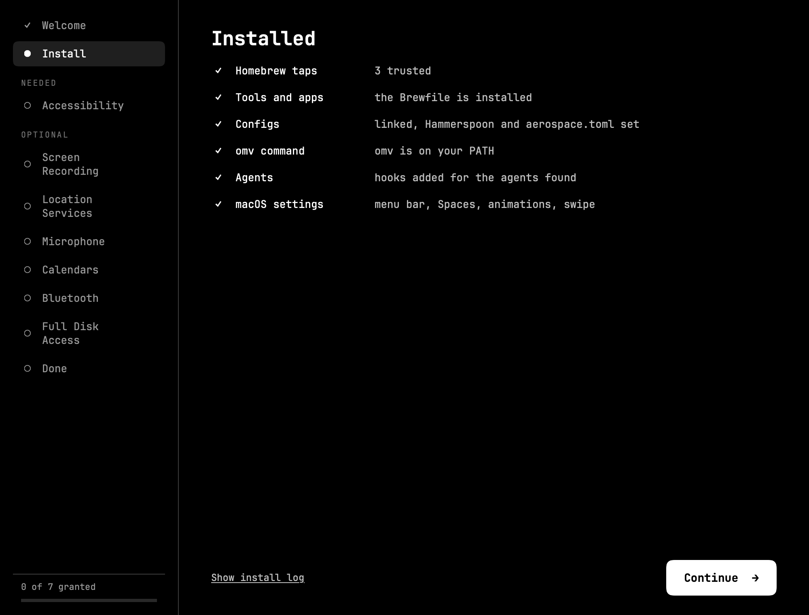

Then, by hand:

1. Log out and back in, so "Displays have separate Spaces" and macOS's three-finger swipe turn off.
2. If the menu bar still shows, set System Settings > Menu Bar > "Automatically hide and show the menu bar" to Always.
3. In System Settings > Displays > Arrange, leave each display a free bottom corner, because AeroSpace hides windows there.
4. Open SwipeAeroSpace and turn on Launch at Login in its Settings.
5. Open Hammerspoon. On its first start it installs the `hs` command, into `/opt/homebrew/bin` on Apple Silicon or `/usr/local/bin` otherwise, which the bar's clicks and `omv doctor` use to reach it.

It also puts the `omv` command on your PATH, next to Homebrew's commands. From then on:

```sh
omv doctor            # check the setup; omv doctor --fix clears a jam
omv flags             # list feature flags; omv flags <name> on|off
omv theme             # list themes; omv theme <name> switches
omv displays          # the display names a display profile's when can use
omv version           # the commit omv is at
```

### Update

```sh
omv update
```

Pulls the latest omv, installs what the `Brewfile` added (it upgrades nothing already installed; `brew upgrade` stays yours to run), relinks every config (Stow links files one by one, so a new file has no link until then), runs any migrations, reloads Hammerspoon and the bar, then runs `omv doctor --fix`, which clears a second bar or a SwipeAeroSpace that quit along the way. It only updates a clean `main`: with changes of your own in the omv folder, it stops and says so.

If the doctor finds a problem after an update, try `omv doctor --fix` first. If that doesn't help, go back to where you were:

```sh
omv update --undo
```

Undo refuses when it would lose something: changes in the omv folder, commits made since the update, or an update that ran a migration, which resetting the code can't reverse. An update that pulled nothing keeps the way back to the last one that did.

Migrations are scripts in `migrations/` that run once each, in name order, for changes a pull alone can't make, such as moving a file. The ones that ran are listed in `~/.local/state/omv/migrations`; `migrations/README.md` has the rules for writing one.

### Your settings

Your own changes go in `~/.config/omv/`, outside the omv folder, so `omv update` never touches them and they never stop an update. Each of omv's configs loads yours last, so your lines win. A file that's missing means omv's defaults; omv creates none of them.

| File | For | Example |
|---|---|---|
| `aerospace.toml` | AeroSpace | `[gaps]` then `inner.horizontal = 4` |
| `ghostty` | Ghostty | `font-size = 15` |
| `sketchybar.sh` | SketchyBar | `sketchybar --bar height=36` |
| `hammerspoon.lua` | Hammerspoon | `hs.hotkey.bind({ "alt" }, "q", function() hs.alert("hi") end)` |
| `nvim.lua` | Neovim | `vim.opt.number = true` |
| `flags` | Feature flags | `file-search=on` (or `omv flags file-search on`) |
| `apps` | The browser and editor omv's keys open | `browser = Google Chrome` |
| `workspaces` | [Workspaces](#your-own-workspaces), their screens and apps, and each screen's gaps; applied when saved | `[workspace 1]` then `on = DELL` and `apps = Zed` |
| `away-digest` | How long a break must be before unlocking opens the agents' inbox; read each time, so no reload | `minutes = 10`, or `minutes = 0` for every break |
| `clocks` | World clocks in the calendar card, with the `world-clocks` flag on; read each time the card opens, so no reload | `NYC = America/New_York` |
| `theme-clock` | A day theme and a night theme, switched at sunrise and sunset; read each time, so no reload | `day = catppuccin-latte` then `night = vantablack` |

After editing one, run:

```sh
omv reload
```

AeroSpace has no way to load a second file, so omv builds `~/.config/aerospace/aerospace.toml` from its defaults and yours: a key you set replaces omv's in the same table, a key or table omv doesn't have is added, and your `[[on-window-detected]]` rules come after omv's. Edit `~/.config/omv/aerospace.toml`, not the built file. An `aerospace.toml` that omv didn't build is moved to `aerospace.toml.before-omv` (or a name ending in the time, if that one exists), never deleted. If yours has a line omv can't read, the old built file stays and `omv reload` names the line.

An error in `hammerspoon.lua` or `nvim.lua` shows as an alert, and omv's keys keep working.

### Doctor

```sh
omv doctor
```

Checks that everything is in place, and says how to fix what isn't: the tools, apps and font, that every package is linked with no broken links left behind, that AeroSpace, SketchyBar, borders, Hammerspoon and SwipeAeroSpace are running with the omv config loaded, the macOS settings, AeroSpace's Accessibility, and the Claude usage line. It also finds a jam: `hs` calls stuck for more than a minute, more than one SketchyBar, or a Hammerspoon that doesn't answer in 5 seconds. Without `--fix` it only reads, and exits non-zero when something fails.

`omv doctor --fix` first clears a jam, saying each step: it kills stuck `hs` calls, restarts SketchyBar when more than one runs, reopens Hammerspoon when it's running but doesn't answer, and opens SwipeAeroSpace when it's installed but not running. Then it checks as usual. It starts nothing else that wasn't running, and leaves the other problems to their printed fixes. Between checks, Hammerspoon watches the bar every 10 seconds, without starting a process: one gone for 10 seconds while AeroSpace runs is started again, at most once a minute, and each start is written to `~/.local/state/omv/stalls.log`.

It also lists what macOS doesn't let a script read, to check by hand: Screen Recording for Hammerspoon, Calendar access for "omv agenda", Location Services for Hammerspoon, Microphone access for "omv meter", and Accessibility for SwipeAeroSpace.

### What's inside

```
bin/omv        the one command
config/        what omv configures: one GNU Stow package per app, plus hammerspoon/
agents/        how omv talks to coding agents: Stow packages and the hook scripts
install/       install, uninstall and doctor, run through omv
migrations/    changes a pull alone can't make, run once each by omv update
```

| Folder | Links | What it does |
|---|---|---|
| `config/aerospace` | nothing: omv builds `~/.config/aerospace/aerospace.toml` from it | Tiling, workspaces and window keys |
| `config/sketchybar` | `~/.config/sketchybar` | The top bar and its plugins |
| `config/hammerspoon` | nothing: Hammerspoon loads it in place | App keys and every card: menus, lists, calendar, reminders, capture, sound, network, battery, weather, disk |
| `config/ghostty` | `~/.config/ghostty` | Terminal config and window scripts |
| `config/nvim` | `~/.config/nvim` | Neovim config |
| `config/btop` | `~/.config/btop` | btop config |
| `config/swipeaerospace` | `~/.config/swipeareospace` | Three-finger swipe between workspaces |
| `agents/claude` | `~/.claude/bar-usage.sh` | Feeds Claude's usage limits to the bar |

## Uninstall

```sh
omv uninstall        # removes AeroSpace, SketchyBar, borders and SwipeAeroSpace, keeps the older tool links
omv uninstall --all  # also unlinks ghostty, nvim and btop, and sends Hammerspoon back to ~/.hammerspoon
```

It:

1. Quits AeroSpace, SwipeAeroSpace, SketchyBar and borders, and stops keep-awake if it is on.
2. Removes the Claude usage line from your status line wrapper.
3. Unlinks the packages.
4. Returns the macOS, animation, dragging and trackpad settings to their defaults.
5. Uninstalls the four tools and untaps their taps.
6. Prints the steps left for you.

It leaves this repo, other Homebrew packages, fonts, `~/.config/omniwm` and `~/.config-backup` alone.

## Resource use

It won't slow the Mac down or noticeably drain the battery: together, these tools use less than a tenth of one CPU core even while you work, mostly AeroSpace reacting as windows open, close and move.

Memory, measured on a MacBook Pro (M3 Pro, 18 GB) with everything running and no card open, in three runs over two hours. It's each process's footprint, the figure Activity Monitor shows.

| Process | Memory |
|---|---|
| AeroSpace | 37–139 MB |
| borders | 40–45 MB |
| Hammerspoon | 27–36 MB |
| SwipeAeroSpace | 34 MB |
| SketchyBar | 23–24 MB |
| **Total** | **161–278 MB** |

- AeroSpace's memory varied the most: it was 136–139 MB in two runs and 37 MB in one. SketchyBar stayed steady.
- Hammerspoon takes 27 MB when it starts and 36 MB once the cards have been opened.
- borders draws the focus outline at 1x (`hidpi=off`). At 2x it took 149–209 MB for an outline that looks the same.
- The cards are drawn by one WebKit view that is made once and hidden between uses. WebKit runs it in a process of its own, which isn't in the table.
- The helpers run only when needed: "omv agenda" for a moment every 5 minutes, and "omv meter" only while the Sound card is open.
- The bar watchdog asks macOS about SketchyBar every 10 seconds without starting a process, about 0.06 ms a check; with it, Hammerspoon idles at 0.42% of one core, as it did without it.
- While dictation's pill shows, it uses about 6% of one core: Hammerspoon 3.9%, redrawing the pill only when its text changes, and the dictation helper 2.2%, which draws the wave 30 times a second on the GPU with Core Animation. Drawn by Hammerspoon, the wave took about a fifth of a core. It's nothing once the pill hides.

The features that start off cost little once turned on. Measured on a MacBook Pro (M3 Pro) with all six on:

| Feature | What it costs |
|---|---|
| `system-load` | `ps` and `sysctl` every 10 seconds: about 0.02s of CPU a run, 0.2% of one core |
| `brew-outdated` | `brew outdated` every 6 hours and on waking, at most once an hour: about 0.5s of CPU a count |
| `browser-tabs` | one `osascript` each time the palette opens, in the background: about 0.1s with 2 tabs open |
| `input-source`, `in-use` | nothing while nothing changes: macOS says when the input source or a device's use changes |
| `world-clocks` | nothing while the calendar card is closed; the card works out the times itself |

With all six on, Hammerspoon's footprint stayed at 47–49 MB over four hours, and its Lua memory came back to where it started.

## Tests

```sh
tests/run.sh
```

The tests use stubs and a temporary `HOME`, so they never change the real system. They need `stow`, `python3` and `luajit`.

`docs/shoot.sh` retakes the card screenshots in `docs/`, or only the ones named, such as `docs/shoot.sh disk wifi`. Each card is drawn from the sample data in `docs/shots.lua`, so no real network, place, event or path ends up in an image, and opens on the built-in Retina screen to come out at 2x. It needs Hammerspoon and an unlocked screen. A test fails when the README shows a card image that `docs/shots.lua` doesn't make.

## Differences from the article

- Trusts the taps first, because Homebrew refuses to load untrusted ones.
- Starts SketchyBar from AeroSpace, which the article never does.
- Sets `PATH` and `LANG` for apps started at login.
- Raises the top gap on external displays, so windows don't slide under the bar.
- Pins workspaces to monitors and updates the bar when monitor focus changes.
- Turns off "Displays have separate Spaces", as AeroSpace's guide recommends.
- Makes launch keys switch workspace first, because new windows route away without following.
- Keeps the recovered Vantablack bar and plugins, because the article doesn't copy the example plugins.
