# omv

A keyboard-driven macOS desktop with one look throughout. AeroSpace tiles the windows, SketchyBar draws the top bar, Hammerspoon adds menus, cards and app keys, and Ghostty, Neovim and btop share the Vantablack theme. It started from [Koen van Gilst's setup](https://koenvangilst.nl/lab/aerospace-sketchybar-macos-setup), with the [fixes listed at the end](#differences-from-the-article).

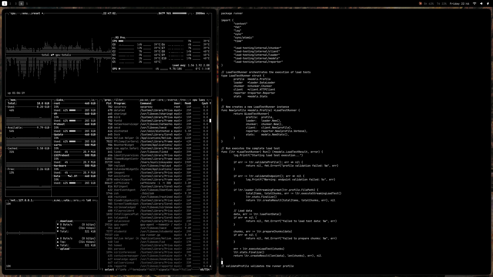

## Features

- [**Tiling and workspaces**](#tiling-and-workspaces): six workspaces with fixed homes for each app, Vim-style keys, Option+Tab back to the last workspace, a tabbed layout, a focus border, and three-finger swipes.
- [**The bar**](#the-bar): workspaces, the playing track, reminders, meetings, Claude usage, and a macOS-style clock that stays clear of the notch.
- [**Palette**](#palette): Option+Space finds any window, app or omv command as you type.
- [**Key list**](#key-list): Option+/ shows every shortcut at once, and runs the one you pick.
- [**System menu**](#system-menu): lock, sleep, restart and reload the tools.
- [**Sound**](#sound): volume, mute, output and input devices, and a live mic level.
- [**Wi-Fi and Ethernet**](#wi-fi-and-ethernet): the network, signal, address and router, a click away.
- [**Agents**](#agents): Claude Code's session and weekly limits, one click to continue or start a session, and a pill when a session waits for you.
- [**Battery**](#battery): charge, time left, cycles and power draw.
- [**Weather**](#weather): the temperature in the bar, and a three-day forecast for wherever the Mac is.
- [**Calendar and today's events**](#calendar-and-todays-events): click the clock for the month and today's Calendar.app events.
- [**Reminders and Pomodoro**](#reminders-and-pomodoro): `25m check deploy`, or `pomo` for focus blocks with break cards and a long break after every fourth.
- [**Disk**](#disk): free space in the bar once it runs low, and Mole's cleanups a key away.
- [**Lyrics**](#lyrics): the playing song's lyrics in a window that tiles, the line being sung large in the middle.
- [**Capture menu**](#capture-menu): screenshots, text and QR codes from the screen, a color picker, and screen recordings.
- [**Volume and brightness**](#volume-and-brightness): omv's own pop-ups, and the brightness keys dim an external display too.
- [**Do Not Disturb**](#do-not-disturb): the Focus that's on, in the bar, and a switch in the system menu.
- [**Tailscale**](#tailscale): connect, disconnect, and copy any device's address.
- [**Smaller tools**](#smaller-tools): keep the Mac awake, copy the browser's URL, a drop-down terminal, and notifications when long commands finish.
- [**Doctor**](#doctor): `./doctor.sh` checks the tools, links, running services and settings, and says how to fix whatever is wrong.

Every card shares one design: a black card with a gray border, a title that doubles as a search field, and Up, Down, Enter and Escape to drive it. With two displays, a card opens on the one the pointer is on, so a click on the bar opens it on that display. A card that belongs to a bar item, such as Agents, Wi-Fi or the calendar, opens just under that item.

## Tiling and workspaces

Every shortcut starts with Option. Option alone goes somewhere or acts on the current window, and adding Shift takes the window with it or launches an app. H/J/K/L mean left, down, up and right, as in Vim.

| Workspace | Apps | Monitor |
|---|---|---|
| 1 | Ghostty | Main |
| 2 | Zed | Main |
| 3 | Helium | Main |
| 4 | Obsidian, Notion, Linear | Secondary, or main if there is only one |
| 5 | Notes, Messages, WhatsApp, Discord | Secondary, or main if there is only one |
| 6 | Apple Music, Spotify | Secondary, or main if there is only one |

- **Each app opens on its workspace.** Finder tiles on the current workspace instead, though its Get Info windows float, and System Settings and Calculator float there.
- **Six workspaces in total,** not six per monitor, because AeroSpace workspaces are global. A pinned workspace always opens on its own monitor, so Option+4 from the main monitor moves focus to the secondary one. When the secondary display is unplugged, workspaces 4-6 move to the main one, and they return when it's plugged back in.
- **Focus border:** the focused window gets a 2pt gray outline, the same gray as the cards' border, drawn by [JankyBorders](https://github.com/FelixKratz/JankyBorders). It starts with AeroSpace. It's drawn at 1x (`hidpi=off`), which takes about 40 MB instead of up to 209 MB. For a sharper outline on Retina, change `hidpi=off` to `hidpi=on` in `aerospace.toml`, then run `pkill -x borders` and restart AeroSpace.
- **Trackpad:** swipe three fingers left or right to move one workspace, wrapping around. A swipe stays on the focused monitor, so with two monitors it cycles 1-3 on the main one and 4-6 on the secondary.
- **Option+Tab** goes back to the previous workspace.
- **Tabbed layout:** Option+A switches the workspace between tiles and tabs. In tabs, the focused window takes almost the whole width and the others peek out at the edges, which suits a laptop screen. Option+H / L move between them. AeroSpace remembers the layout per workspace.
- **Dragging:** Ctrl+Cmd+drag moves a floating window by any part of it. A tiled window snaps back to its tile when you let go.
- **Resize mode:** Option+Shift+R, shown as `RESIZE` in the bar. H / L make the window narrower / wider, and K / J shorter / taller. Escape or Enter leaves, and other shortcuts stay off until you do. Height only changes when windows are stacked vertically.
- **btop** opens on workspace 1 when AeroSpace starts, unless one is already running.

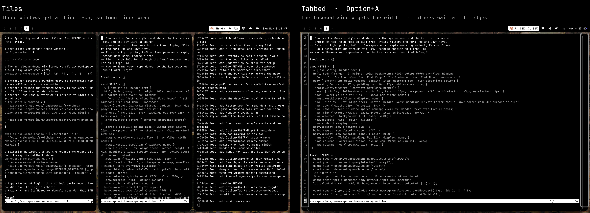

## The bar

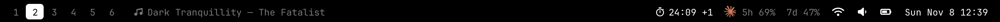

**On the left**, workspace numbers: the focused one is a white pill, and the one visible on the other monitor is a gray pill. Click a number to go there, or scroll over them to move one workspace at a time across all six, wrapping around. The binding mode shows next to them while it isn't the normal one.

While Music or Spotify plays, the track follows as `Artist — Title`, cut at 40 characters. Click it to play or pause, right-click it for the [lyrics](#lyrics), and scroll for the next or previous track. It hides when nothing plays and never opens a player that is closed.

**On the right**, from left to right:

| Item | Shows | Click | Scroll |
|---|---|---|---|
| Meeting | The next Calendar event's start time, from an hour before | Join its video call, or open the [calendar](#calendar-and-todays-events) | |
| Reminder | Time left on the next reminder, plus `+N` for others | List them, to cancel one | |
| Pull requests | How many open pull requests ask for your review, checked with `gh` every 5 minutes. Hidden when none wait, or when `gh` is missing, logged out or offline | List them; Enter opens one in Helium | |
| Claude | The 5-hour usage limit, as `5h 23%` | Open the [Agents card](#agents) | |
| Waiting Claude | A white pill right of Claude's limit, `omv`, while a Claude Code session waits for you, or `? omv` while it asks for approval, plus `+N` for others | Go to that session's terminal, or pick one when several wait | |
| Disk | Free space on the startup disk, only while it's under 20 GB or under 10% | Open the [Disk card](#disk) | |
| Keep-awake | A crossed-out Zzz, while keep-awake is on | Turn it off | |
| Weather | Condition and temperature, where the Mac is | Open the [weather card](#weather) | |
| Ethernet | A plug, only while a cable is connected | Open the [Ethernet card](#wi-fi-and-ethernet) | |
| Bluetooth | On or off, only with `blueutil` installed | Open the [Bluetooth card](#bluetooth) | |
| Wi-Fi | Connected or not | Open the [Wi-Fi card](#wi-fi-and-ethernet) | |
| Volume | Level | Open the [Sound card](#sound), with either button | Change the volume by 5% |
| Battery | Charge | Open the [Battery card](#battery) | |
| Clock | Date and time, as `Sun Nov 8 12:09` | Open the [calendar](#calendar-and-todays-events) | |

**Clear of the notch:** when the right side gets too full, items give way in this order until it fits: Claude's limit (its logo stays), then the meeting's time (its icon stays), then the weather's temperature (its icon stays), then the Claude logo. Keep-awake, low disk space, the waiting Claude, the pull request count, the reminder and the status icons always stay, and everything comes back once there's room.

**Claude usage** shows the 5-hour limit: gray under 70%, white from 70%, and a white pill from 90%. The 7-day limit is in the [Agents card](#agents).

- The numbers come from Claude Code's status line, so they only update while Claude Code runs. Usage from elsewhere, such as claude.ai, shows after your next response in Claude Code.
- A window past its reset time shows 0%.
- Once the 5-hour limit reaches 90%, a reminder is set for its reset, "Claude's 5-hour limit has reset", once per reset.
- `install.sh` adds one line to `~/.claude/statusline-wrapper.sh` through `claude-usage.sh`. If that file doesn't exist, the item stays hidden.
- Only the four numbers are stored, in `~/.local/state/omv/claude-usage`.

Option+Shift+Space shows or hides the bar.

## Palette

Option+Space opens one list, like Omarchy's: every open window with its app and workspace, then every app in `/Applications`, `/System/Applications` and `~/Applications`, then every omv command the [key list](#key-list) can run, such as the Wi-Fi card or the capture menu. Type to filter by name, app, workspace number or key, and press Enter to go to the window, open the app or run the command.

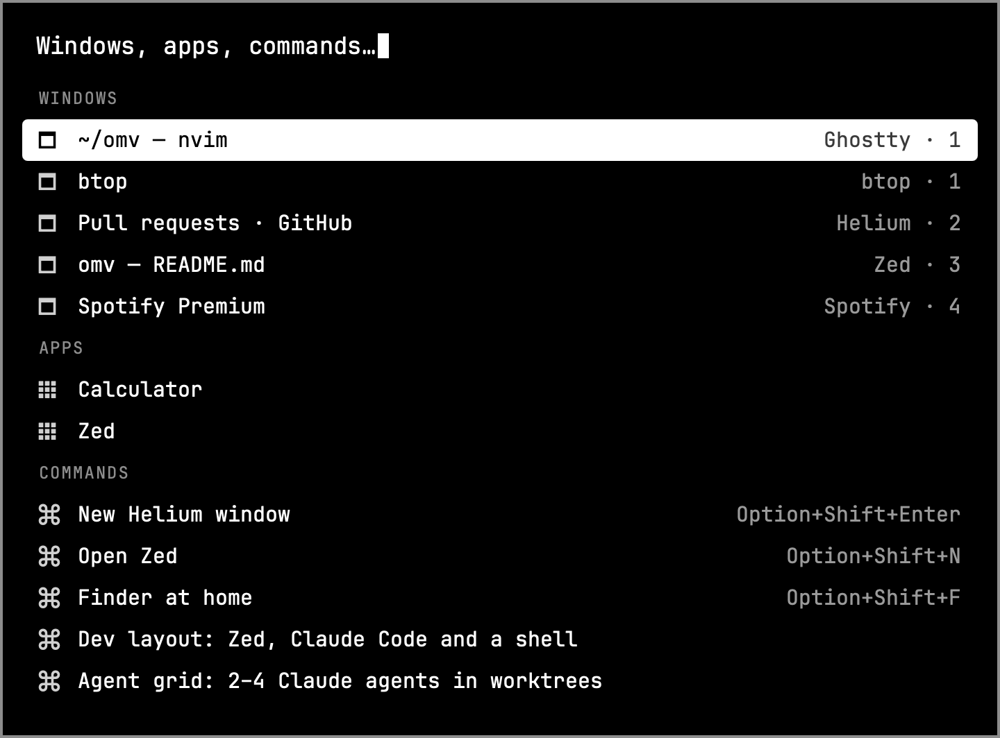

## Key list

Option+/ shows every key at once, in a searchable two-column list. Type to filter by description or key, and press Enter (or click) on a row to run that shortcut: the list closes, focus goes back to your window, and the action runs. The list is built from `aerospace.toml` and `init.lua`, so it never goes stale.

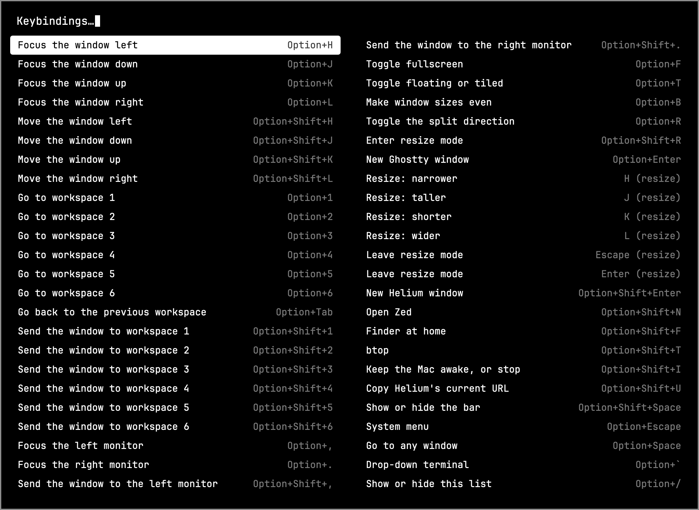

## System menu

Option+Escape opens a menu modeled on Omarchy's.

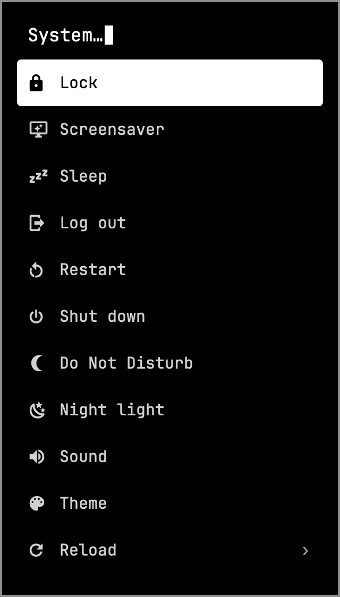

| Item | Does |
|---|---|
| Lock | Locks the screen |
| Screensaver | Starts the screensaver |
| Sleep | Puts the Mac to sleep |
| Log out, Restart, Shut down | Ask first, with Cancel selected |
| Do Not Disturb | Switches [Do Not Disturb](#do-not-disturb) on or off |
| Sound | Opens the [Sound card](#sound) |
| Theme | Opens the [theme picker](#themes) |
| Reload › | Reloads AeroSpace, SketchyBar, Hammerspoon, or all three |

Type to filter, Up and Down to move, Enter or Right to pick, Left or Backspace to go back, and Escape or a click elsewhere to close.

## Themes

Option+Escape, then **Theme**, picks the colours for the cards, the bar, Ghostty and the focused window's outline. **Vantablack** is built in and stays the default. **Get Omarchy's themes** downloads the colours of [Omarchy's](https://github.com/basecamp/omarchy) themes (MIT), such as Tokyo Night, Gruvbox and Nord, and lists them; nothing else is fetched, and only when you pick it.

- **Cards** take the new colours at once. Each gray keeps its place between the theme's background and foreground, so a theme recolors every card without changing its look.
- **The bar** reloads with the theme's colours.
- **Ghostty** takes them in new windows, or after its own config reload, Cmd+Shift+,.
- **The focused window's outline** takes the theme's accent.
- **The lyrics window** redraws in the new colours at once.
- The choice is saved in `~/.local/state/omv/theme`, so it survives reloads and restarts. Neovim and btop keep their own colours.

## Sound

Click the volume item in the bar, or press Option+Shift+V, for the Sound card under it.

- **Header:** the output in use, and a switch that mutes and unmutes.
- **Output:** a volume slider, then every output device, with the one in use highlighted. Click one to switch to it. They're read each time the card opens, so AirPods show up as soon as they connect.
- **Input:** a volume slider for the mic, a live level meter, then every input device.
- Virtual devices, such as the ones Zoom and Teams add, are left out unless they're in use.
- **Keys:** Up and Down move through the devices, Enter picks one, Left and Right change the volume by 5%, M mutes, and Escape or a click elsewhere closes.
- **Live:** while the card is open, it follows changes made elsewhere: the volume keys, mute, and devices connecting or switching. A slider you're dragging keeps its place.
- **The level meter** comes from a small Swift helper, `meter.swift`, built the first time into `~/.cache/omv/Meter.app`. It listens only while the card is open, so macOS shows its orange microphone dot until the card closes. The first time, macOS asks to let "omv meter" use the microphone. If you refuse, the meter stays empty and the rest of the card still works.

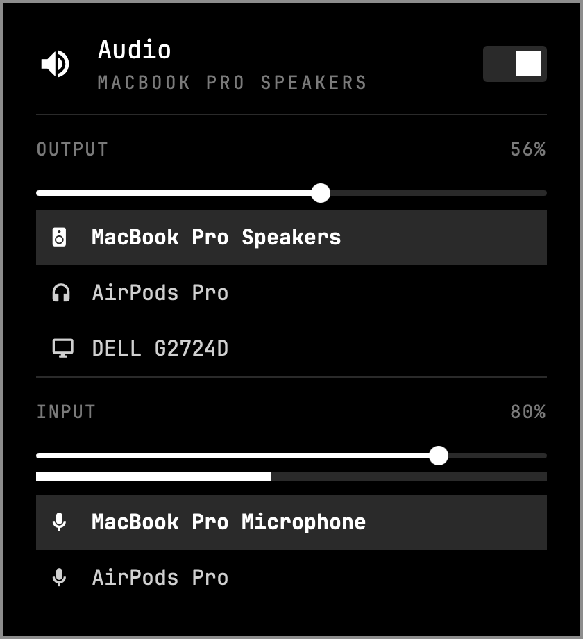

## Wi-Fi and Ethernet

Click the Wi-Fi item, or press Option+Shift+W, for the Wi-Fi card: the network's name, the signal as a percentage and in dBm, the IP address, the router and the channel. **Turn off** (or **Turn on**) switches Wi-Fi, and **Settings** opens Wi-Fi in System Settings.

The Ethernet item shows only while a cable is connected. Click it, or press Option+Shift+E, for the Ethernet card: the link speed, the IP address, the router, the port and the duplex, and **Settings** for Network in System Settings. With more than one cable, it shows the one the Mac's traffic goes out by.

Both cards have **Speed test**: macOS's own `networkQuality` measures the download and upload speed against Apple's servers in about 15 seconds, and the card shows them under Download and Upload until the next test.

Left and Right move between the buttons, Enter presses one, and Escape or a click elsewhere closes.

Both cards follow changes while they're open, such as Wi-Fi turning off, joining a network, the signal or a cable being unplugged, and keep the selected button. The bar's Wi-Fi and Ethernet icons change at once too: Hammerspoon watches for these changes rather than checking on a timer.

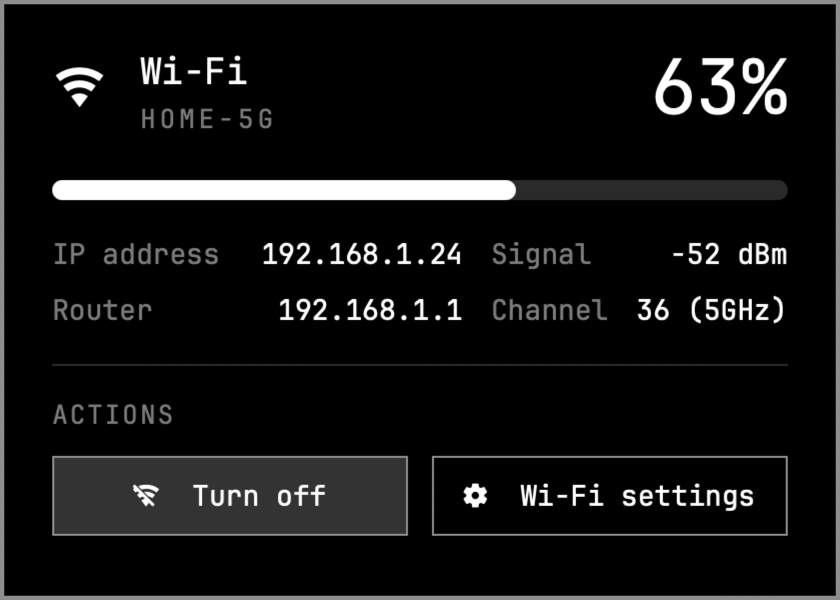 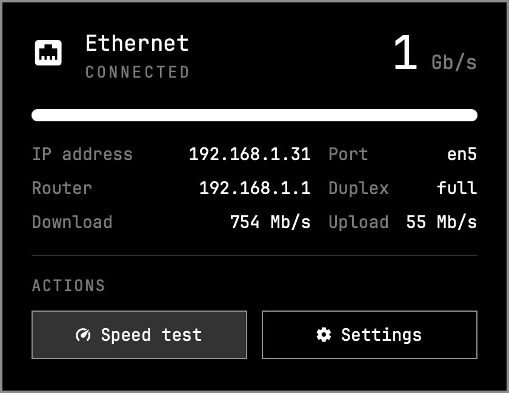

Since macOS 14, an app needs Location Services to read the Wi-Fi network's name. Hammerspoon asks for it once, for the weather, and without it the card shows `—` for the name.

## Bluetooth

Click the Bluetooth icon, or press Option+Shift+Y, for the Bluetooth card under it: a switch that turns Bluetooth on or off, then your paired devices, connected ones first. Enter on a device connects or disconnects it, which takes a few seconds; the card redraws when it's done.

- Paired devices are listed under **My devices**, and the search under **Nearby**. **Pair a new device…** searches for devices in pairing mode for as long as the card is open, up to 2 minutes, and lists the ones not yet paired as each 10-second round ends; Enter on the searching row stops it. Dimmed lines, such as "Put the device in pairing mode", are only text: the selection passes them by. Enter on a device pairs and connects it, and its row says pairing…, then connecting…, and it's selected among the paired devices when done. A failed pairing says so with Enter to retry; a second failure points to Bluetooth Settings. Pairing and connecting give up after 20 seconds.
- The search finds classic Bluetooth devices, such as AirPods, speakers and most headphones. Bluetooth Low Energy devices, such as many newer keyboards and mice, don't show up, and a device that asks you to type a PIN can't be paired here: when nothing is found, the card points to Bluetooth Settings.
- Connecting or disconnecting a paired device shows connecting… or disconnecting… on its row, and couldn't connect when it fails. The selection stays on the row you chose while the card redraws.
- **Bluetooth Settings**, the last row, opens System Settings for anything else, such as those devices or forgetting one.

- It reads and changes Bluetooth through [blueutil](https://github.com/toy/blueutil): `brew install blueutil`. Without it, the bar item stays hidden and the card says how to install it.
- Hammerspoon needs Bluetooth access: System Settings > Privacy & Security > Bluetooth, turn on Hammerspoon (add it with + if it's not listed). macOS may not ask by itself. Until then, the bar item stays hidden and the card's one row opens that setting. The bar reads Bluetooth's state through Hammerspoon, so SketchyBar needs no access of its own.

## Agents

Click Claude's item in the bar for the Agents card: Claude Code's plan, and bars for the session (5-hour) and weekly limits with the time until each resets.

- **>_** continues your last Claude Code session, in the folder it ran in, with `claude --continue`.
- **+** lists the folders you've used Claude Code in, most recent first. Type to filter, and Enter starts a new session there.
- **󰋚** lists your recent sessions, newest first, each named by the title Claude Code gave it, else by its folder, with the folder and its age, such as `omv · 2h ago`. Type to filter, and Enter resumes it with `claude --resume`.
- All three open a Ghostty window on workspace 1. Left and Right move between the buttons, and Enter presses one. Folders that no longer exist are left out of all three.
- **Sessions:** under the limits, a row for each live Claude Code session, with its folder, its state and how long it has been in it, such as `asks · 3 min`. Sessions asking for approval come first, then the ones done, then the ones working. Down and Up move through them, and Enter goes to that session's terminal. With no session running, the card looks as before.
- **Background:** Claude Code's background sessions, the ones started with `claude --bg` or moved there with `/bg`, are listed under BACKGROUND, by name with their folder and state, such as `sila-v1 · asks`. They're read from `claude agents --json`, so they show even with the background service off. Enter opens one in a new Ghostty window on workspace 1, with `claude attach`. Hovering one shows a × at its right; clicking it, or `x` on the selected row, removes it after asking with Cancel selected: it runs `claude stop` and `claude rm`, so it leaves the list but its conversation stays, for `claude --resume`. When Claude's background service isn't running, it's started just for this and stopped after, leaving other sessions running.
- The plan comes from `~/.claude.json`, and only its `organizationType` is read. The folders come from Claude Code's own session files in `~/.claude/projects`.
- `claude` runs through your login shell, by `claude-in.sh`, so it's found on the PATH your shell sets up.

**Other agents.** Codex, OpenCode and pi sessions show in the same pill, list and Agents card as Claude's, with the agent's name in the card, such as `codex · asks · 3 min`. Each reports through the same hook script as Claude Code, and `install.sh` sets up only the agents it finds:

- **Codex** (`~/.codex`): `codex-hooks.sh` adds hooks to `~/.codex/hooks.json` for when you send a prompt, a tool runs, Codex asks for approval, and it stops. Other hooks, such as herdr's, stay. Codex asks once to trust new hooks: run `/hooks` in Codex.
- **OpenCode** (`~/.config/opencode`): a plugin, `omv-agent-state.js`, is linked into its `plugins` folder. Subagents' sessions are left out; their parent stands for them.
- **pi** (`~/.pi/agent`): an extension, `omv-agent-state.ts`, is linked into its `extensions` folder. pi asks for no approvals, so its sessions are working or done.
- `uninstall.sh` removes all three, and `doctor.sh` checks each agent that's set up.

**Waiting sessions.** When Claude Code finishes or asks for approval, a white pill shows the session's folder, as `? omv` when it asks for approval, since that one is blocked until you answer. It sits right next to Claude's logo and 5-hour limit, so the two read as one group, and the limit stays in view. Click it, or press Option+Shift+A, to go to the session's terminal, even in another tab or on another workspace. When several sessions wait, a list opens with the asking ones first, then the one waiting longest, and each row shows its state and how long it has waited. The pill goes when you answer, when a tool runs after your approval, or when the session ends. Working sessions never show in the pill, only in the Agents card.

- **Seen sessions leave the pill.** While Ghostty is in front, the session in the terminal you're looking at is marked seen, so it leaves the pill until its state changes: a session that finishes, then asks, shows again. Ghostty is read every 2 seconds, and only while it's in front.
- **A notification when a session asks.** A session that starts asking for approval in a terminal you're not looking at sends a notification, "omv · needs your approval". Clicking it goes to that session. A session that only finishes never notifies; the pill covers that.

- `install.sh` adds hooks to `~/.claude/settings.json` through `claude-hooks.sh`: `UserPromptSubmit` and `PostToolUse` mark a session as working, `Stop` as done, a `Notification` that asks for you, such as one for approval, as asking, and `SessionEnd` removes it. Other notifications change nothing. Other hooks and settings stay as they are, and `uninstall.sh` removes only these.
- The session's terminal is found by its tty, in Ghostty, iTerm2 or Terminal, through each app's AppleScript, Ghostty first. A terminal app that isn't running is skipped, so it never opens on its own. The first time, macOS asks to let Hammerspoon control that app.
- Only Claude's PID, its tty, the folder name, the state and when the session entered it are saved, in `~/.local/state/omv/claude-sessions`. A session whose Claude has ended is dropped within 30 seconds.
- A session in any other app, such as Zed's terminal, still shows. Since no terminal app has its tty, the app it runs in comes forward instead, found among Claude's parent processes; macOS can't pick the exact window or pane. The drop-down terminal can't be focused.

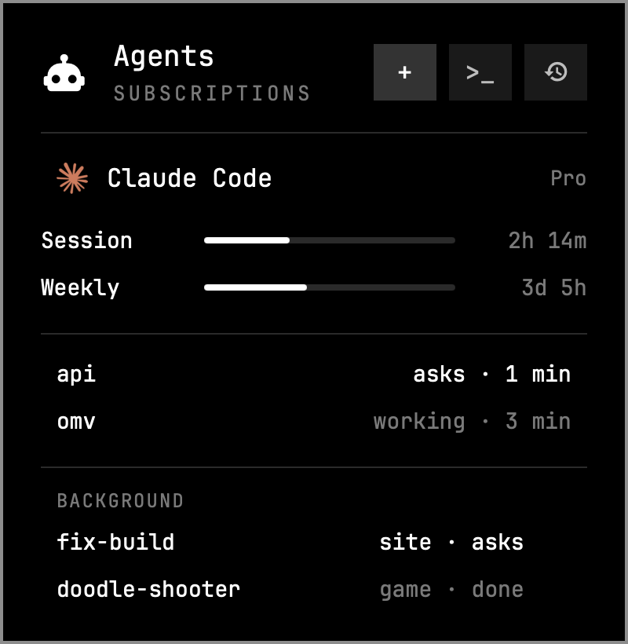

## Battery

Click the battery item, or press Option+Shift+B, for the Battery card: the charge, whether it's draining, charging or charged, the battery's size in Wh, the time left (or to full), the charge cycles and the power going in or out.

While the card is open, it follows the charge and charging as they change, and the bar's battery icon changes with them.

**Battery settings** opens System Settings, where Low Power Mode is. The card doesn't switch it itself: macOS lets only its own apps do that without an admin password.

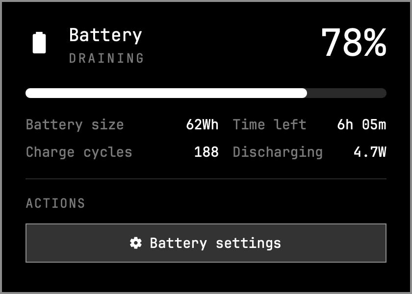

## Weather

The weather item shows the condition and the temperature where the Mac is. Click it, or press Option+Shift+O, for the weather card: the temperature, what it feels like, wind and humidity, and the next three days' highs and lows.

- The location comes from macOS's Location Services. The first time, macOS asks to let Hammerspoon use it. The city's name comes from macOS too.
- The weather comes from [Open-Meteo](https://open-meteo.com), which needs no key. Only the location, rounded to about a kilometre, is sent.
- It's read when Hammerspoon starts, every 30 minutes, when the Mac wakes, and when the card opens.
- When a reading fails, the last one stays. With none yet, the item stays hidden and the card says why.

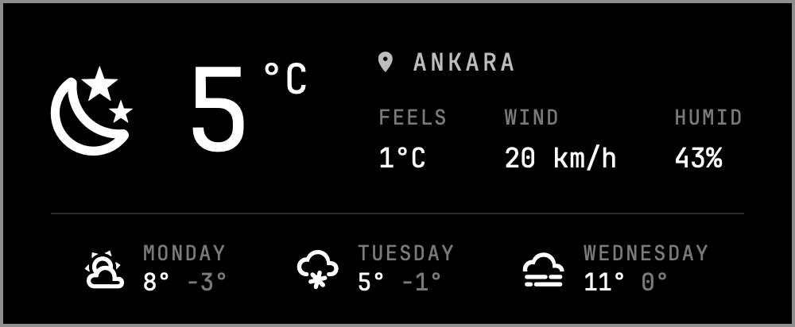

## Calendar and today's events

Click the clock for a calendar card. Weeks start on Monday and show their ISO week number, today is a white square, and the footer shows today's date and week. Left and Right (or ‹ and ›) change month, T goes back to today, and Escape or a click elsewhere closes it.

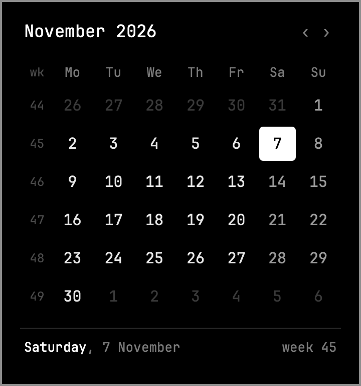

Under the footer are today's events from Calendar.app, so every account added there counts, such as iCloud, Google and Exchange.

- Each event shows its start time, or `all day`. Events already over are dimmed, and the one going on now is white.
- It lists five at most, then `+N more`. When there are more, events already over are left out first. Cancelled events and ones you declined are left out.
- **In the bar,** the meeting item shows the next timed event's start time, as `14:00`, from an hour before it starts. It turns into a white pill 5 minutes before the start and goes away 5 minutes after. All-day events stay out of the bar.
- **Joining:** from 5 minutes before a meeting until it ends, Option+Shift+C or a click on the meeting item opens its Zoom, Google Meet or Teams link. When several meetings can be joined, a card lists them, with the one starting next selected, else the one that started last. With none to join, the calendar card opens. The link comes from the event's URL, else its location, else its notes. Only those links are saved, never the notes themselves.
- Events are read when Hammerspoon starts, every 5 minutes, when the Mac wakes, and when the card opens.
- They're read by a small Swift helper, `agenda.swift`, built the first time into `~/.cache/omv/Agenda.app`. It runs as its own app because macOS asks the app that reads calendars for permission, and Hammerspoon can't ask. The first time, macOS asks to let "omv agenda" access your calendars. If you refuse, the card says so, and you can allow it later in System Settings > Privacy & Security > Calendars.

## Reminders and Pomodoro

Option+Shift+M asks "Remind me…". Type a time, then what to remember, and press Enter.

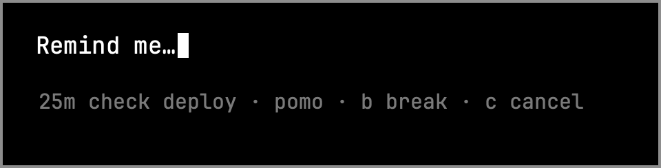

| Type | Does |
|---|---|
| `25m check deploy`, `1h30m stand up` | A reminder. Times use `h`, `m` and `s`, and can be combined |
| `14:30 call`, `9:05 tea` | A reminder at that time, today, or tomorrow when it has already passed |
| `r 25m check deploy` | The same, with an optional `r` |
| `pomo`, `pomo write tests` | 25 minutes of focus, optionally named |
| `b`, `break` | A 5-minute break, straight away |
| `c` | Cancels the soonest reminder |

- The bar shows the time left on the soonest reminder, with a target icon during a pomo and a coffee cup during a break.
- When a plain reminder is due, you get a notification and an alert, and the bar item turns into a white pill with the start of its text, plus `+N` when several are due. It stays until you deal with it: click it for a large card with **Dismiss** (Enter), **Snooze 5 minutes** (`s`) and **Snooze 15 minutes** (`l`). Escape closes the card and leaves the reminder due.
- With nothing due, click the bar item to list your reminders, and press Enter on one to cancel it.
- Reminders are saved in `~/.local/state/omv/reminders`, so they survive a Hammerspoon reload, due ones included. One whose time passed while Hammerspoon wasn't running comes back due, marked late on its card (`LATE · WAS 14:05`), with a "Missed reminder" notification. A Pomodoro or break that passed then is dropped, since its moment is gone.

**Pomodoro.** When a pomo's time is up, the screen dims and a large card takes over. Nothing after it starts on its own: you pick each step.

1. **Time for a break.** The task and today's count, as `2 OF 4 TODAY` with dots. `b` starts the break, which is 15 minutes after every 4th pomo and 5 minutes otherwise, `r` gives 5 more minutes (once per pomo), and `c` skips the break.
2. **Break.** A large countdown, a progress line and a tip that changes each break. The bar shows a coffee cup with the time left. `c` ends it early.
3. **Back to work?** Enter starts the next pomo with the same task, and `c` stops for now.

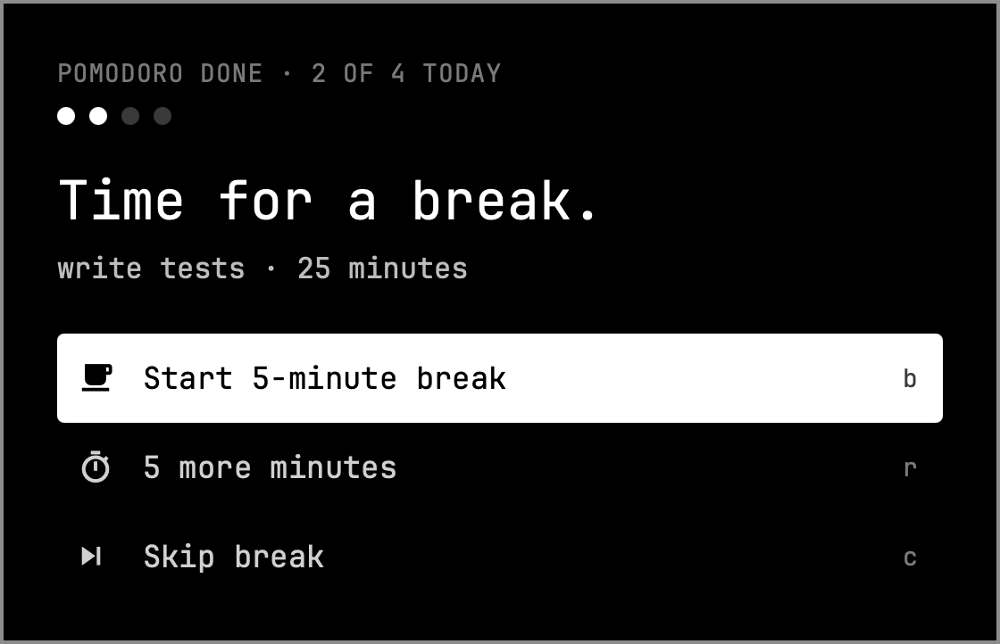
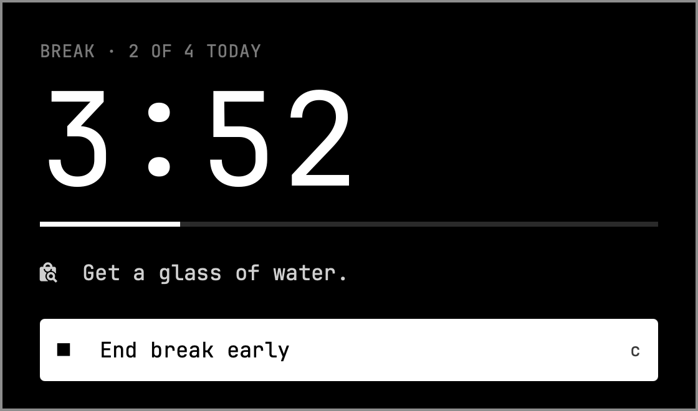
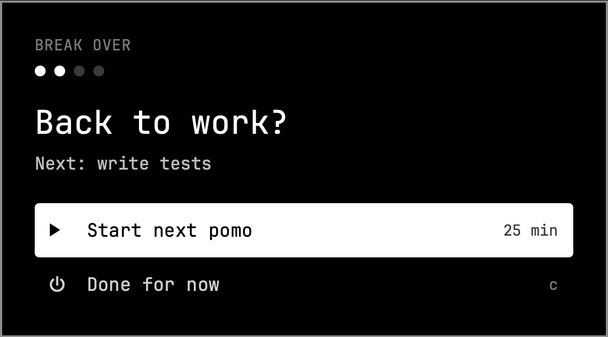

- In a pomo's last 30 seconds, the bar's target item turns into a white pill, so the card never comes as a surprise.
- Escape does the same as `c` on each card.
- The cards stay open when focus moves away, since the break is the point. During a break, clicking the bar item reopens the countdown.
- A break survives a Hammerspoon reload: the bar keeps counting down, and "Back to work?" opens when it ends.
- Today's count is kept in `~/.local/state/omv/pomo` and starts over each day.

## Disk

Option+Shift+X, or a click on the bar's disk item, opens the Disk card. The bar item stays hidden while there's room, and shows the free space once it drops under 20 GB, or under 10% of a larger disk. It's checked with `df` every 10 minutes.

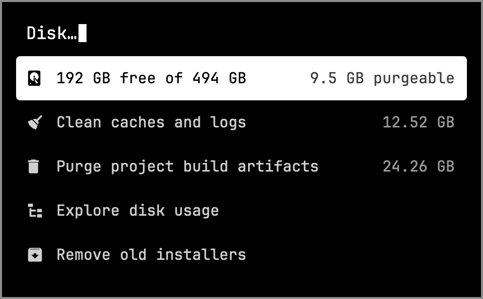

- **First row:** free and total space at once, then the space macOS can purge about a second later, from `mo status --json`.
- **Clean caches and logs** opens `mo clean` in a new Ghostty window. **Purge project build artifacts** opens `mo purge`, **Explore disk usage** opens `mo analyze`, and **Remove old installers** opens `mo installer`. Each one is [Mole](https://github.com/tw93/Mole)'s own interactive command, so you pick what goes; the card itself never deletes anything, and never runs Mole with `--yes`.
- **Sizes beside the rows** come from `mo clean --dry-run` and `mo purge --dry-run`. They take up to two minutes, so they run in the background when the card opens, at most once every 6 hours, and the open card updates when they finish. Until then the row shows `measuring…`. The last sizes are kept in `~/.local/state/omv/disk-clean` and `disk-purge`.
- `mo clean --dry-run` also writes its full list to `~/.config/mole/clean-list.txt`. System caches need sudo, so the background preview leaves them out; `mo clean` may ask for your password to clean them.
- `mo purge` scans `~/workspace`, `~/.claude/worktrees` and `~/.codex/worktrees` among others; `mo purge --paths` changes them.
- Without Mole, the card offers `brew install mole`. `./install.sh` installs it from the Brewfile.

## Lyrics

Right-click the playing track in the bar to open the lyrics in a window of their own; right-click again to close it. Like Ghostty's, the window has no title bar or buttons, only rounded corners. AeroSpace tiles it on the current workspace beside whatever else is there, such as a workout video, and it stays open when focus moves away.

It is made to be read at a glance from across the room, in omv's own look:

- **Line progress:** a bar in the cover's color fills under the line being sung until the next one starts.
- **Lines:** the line being sung is large, a third of the way down. The next one is dimmer, so you can sing ahead, and older lines fade.
- **One color from the cover:** its most vibrant color, moved toward the theme's text color until it reads on the theme's background. A grayscale cover gets the theme's accent instead. It colors the progress bars, the break countdown and a soft glow behind the cover.
- **Theme:** the window takes the [theme's](#themes) colours, and redraws at once when you pick another.
- **Breaks:** before the first line and in instrumental breaks, four squares light up one by one, the last just before singing starts.
- **Cover and track:** a narrow tile shows a small cover above the words, with the title and artist in JetBrains Mono, a progress bar and the time left. A wide window puts a large cover beside them.
- **Paused:** the lyrics dim, the title shows `❚❚`, and everything stops. With Reduce Motion on in System Settings, nothing animates.

How it works:

- It follows Music or Spotify, whichever plays: it counts the position on between reads, and reads the player again every 5 seconds and on every track change, pause or seek.
- Songs with only plain lyrics scroll slowly with the song, still through the intro and outro; scroll by hand and it waits 10 seconds before following again. Instrumentals and unknown songs say so.
- Lyrics come from [LRCLIB](https://lrclib.net), which is sent the track's artist, title, album and length. When that finds nothing, for example for a remaster or a live version, LRCLIB's search is sent the artist and the title without extras such as `(feat. …)` or `- Remastered`. Only an answer by the same artist, with the same title and at most 2 seconds off in length is used, and the window then says `found by search`. The cover comes from the player, or else from Apple's iTunes Search, which is sent the artist and album. Each song's lyrics and cover are fetched once, then read from `~/.local/state/omv/lyrics/`.
- The window is a small helper app, built with `swiftc` into `~/.cache/omv/Lyrics.app` the first time it opens, so that first open takes a few seconds. While a song plays, it uses about 2% CPU: the background is drawn once and never moves.

## Volume and brightness

The volume, mute and brightness keys show omv's own pop-up instead of macOS's: an icon and 16 segments in a card, in the theme's colours, at the bottom of the display the pointer is on.

- **Volume** moves in macOS's 16 steps on the current output. An output macOS can't set the volume of, such as some HDMI displays, keeps macOS's own behavior.
- **Brightness** dims the display under the pointer: the built-in one directly, an external one over DDC with [m1ddc](https://github.com/waydabber/m1ddc). A held key changes the pop-up at once and the display once it settles, since DDC is slow. A display that doesn't answer DDC keeps macOS's behavior.
- Catching the keys needs Accessibility for Hammerspoon, in System Settings > Privacy & Security > Accessibility. Without it, the keys work as macOS's own.

## Do Not Disturb

While a Focus such as Do Not Disturb is on, the bar shows a moon and its name. Option+Escape, then **Do Not Disturb**, or a click on the moon, switches Do Not Disturb.

- The bar reads macOS's own Focus files, which needs Full Disk Access for Hammerspoon, in System Settings > Privacy & Security > Full Disk Access. A Focus on a schedule isn't in those files, so it doesn't show.
- macOS lets nothing but Shortcuts switch a Focus, so omv runs a shortcut named `omv Do Not Disturb`. Make it once in Shortcuts, with the single action **Set Focus**: Do Not Disturb, Toggle. Until it exists, the menu says so and opens Shortcuts.

## Tailscale

Once [Tailscale](https://tailscale.com) is installed, the bar shows its icon, white while connected. Click it for a card: **Connect** or **Disconnect**, then each of your devices with its Tailscale address, online ones first; Enter copies a device's address. While Tailscale needs a login, the first row opens the Tailscale app. omv reads Tailscale's state with its own CLI every 30 seconds, and doesn't install it.

## Capture menu

Option+Shift+S opens a card for screen captures.

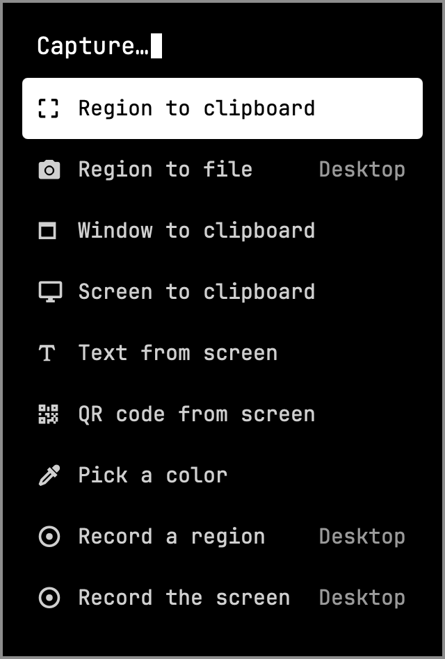

| Item | Does |
|---|---|
| Region to clipboard | Select an area, copy it as a picture |
| Region to file | Select an area, save it to the Desktop, named like macOS's own screenshots |
| Window to clipboard | Click a window, copy it |
| Screen to clipboard | Copy the whole screen |
| Text from screen | Select an area, copy the text in it, read by macOS's Vision framework |
| QR code from screen | Select an area, copy what the QR code in it says |
| Pick a color | Click anywhere, copy its color as `#RRGGBB` |
| Record a region | Drag an area, then record it to the Desktop, named like macOS's own recordings |
| Record the screen | Record the whole display the pointer is on to the Desktop |

While a recording runs, the bar shows `rec`; click it, or press Option+Shift+S again, to stop and save it. Recordings show clicks, and have no sound.

- The first capture asks you to give Hammerspoon Screen Recording, in System Settings > Privacy & Security > Screen & System Audio Recording. Every item except Pick a color needs it.
- Text, QR codes, color and the region to record use a small Swift helper, `capture.swift`, built with `swiftc` the first time and kept in `~/.cache/omv/capture`.

## Smaller tools

- **Keep awake (Option+Shift+I):** runs `caffeinate -di`, keeping the display and system awake during long builds or Claude Code runs. Press the key again or click the icon to stop. It stays on when the bar restarts and turns off at reboot. Only the `caffeinate` it started is checked or stopped, through its process ID in `~/.local/state/omv/keep-awake.pid`. Closing the lid on battery still puts the Mac to sleep, and the key does nothing while SketchyBar isn't running.
- **Copy URL (Option+Shift+U):** copies Helium's current URL. The first time, macOS asks to let Hammerspoon control Helium.
- **Quick note (Option+Shift+D):** a card that grows as you type, with Markdown marks shown dimmed. Enter carries a list on, Tab indents it, and Cmd+Enter saves. One line lands as `- 09:05 call the bank` at the end of today's daily note in `~/Documents/vault/work/00 - Daily/`. Several lines land as a block under `### 09:05`. A note that starts with `# Title` becomes its own page in `~/Documents/vault/work/Inbox/`, numbered when the name is taken, and the daily note gets `- 09:05 [[Title]]`. Escape on an empty card closes it. With text, the first Escape asks: a second Escape keeps the draft for next time, Cmd+Backspace throws it away. The draft is kept in `~/.local/state/omv/note-draft` until you save or discard it, so it survives a Hammerspoon reload. Cmd+O lists the notes in both folders, today's first, then newest first. Enter opens one in the same card to read or edit, and Cmd+Enter saves it, unless it changed in Obsidian since you opened it. Escape goes back a step, first asking when edits would be lost. Listing the folders needs Hammerspoon to have access to Documents. The vault is `~/Documents/vault/work` unless `~/.config/omv/vault` names another on its first line, such as `~/Notes/work`; it's read each time, so a change needs no reload. Every note is written to a temporary file beside it, then put in place, so a failed write never leaves a note cut short. A day without a note gets a plain file, not your template, because Obsidian only applies templates to notes it creates itself.

  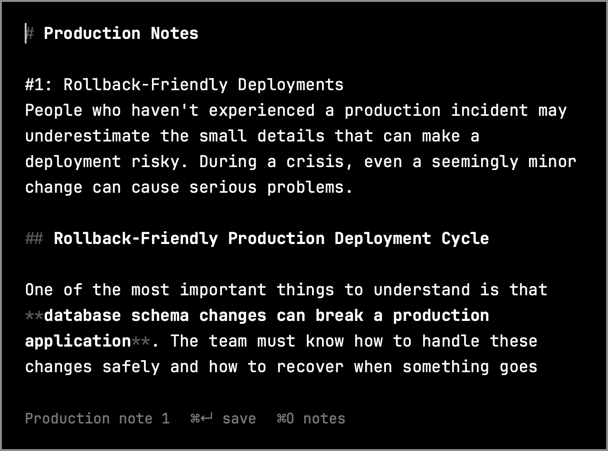

  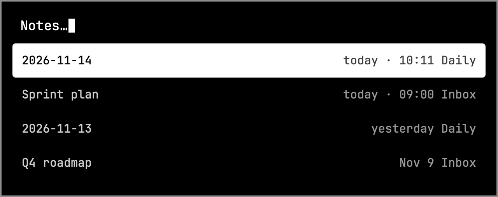

- **Hungry processes (Option+Shift+P):** your 20 busiest processes by CPU, by memory after Tab, or your listening TCP ports after a second Tab, as `:3000  node  ~/workspace/app`, each with the folder it runs in, so a dev server or build an agent left behind is easy to spot. Type to filter, and Enter asks, then quits it. A process still running 3 seconds later is offered Force quit. Only your own processes are listed, never `loginwindow`, `launchd` or Hammerspoon.
- **Clipboard history (Option+V):** the text you copied in the last day, newest first, at most 50. Type to filter, and Enter puts a copy back on the clipboard for you to paste with Cmd+V; pasting for you would need Accessibility, which omv doesn't grant. It's kept in memory only, so a reload forgets it. Secrets are never kept: copies password managers mark as concealed, copies made while 1Password, Bitwarden, Passwords or Keychain Access is in front, and text shaped like a key or token (`sk-…`, `ghp_…`, `AKIA…`, a JWT, a private key, or a `KEY=`, `TOKEN=`, `SECRET=` or `PASSWORD=` line). Only text is kept, never images or files. **Pause history** and **Clear history** are the card's first rows; while paused, the bar shows `paused`, and a click on it turns history back on. A secret with no recognizable shape is still kept, so pause the history for sensitive work.
- **Drop-down terminal (Option+\`):** Ghostty's quick terminal, over any workspace.
- **Long commands:** in Ghostty, a command that runs longer than 10 seconds sends a notification when it finishes while you're in another window. The first one makes macOS ask to allow notifications from Ghostty.
- **Scripting:** each card opens with `hs -c`: `omvToggleSystemMenu()`, `omvToggleSound()`, `omvToggleWifi()`, `omvToggleBluetooth()`, `omvToggleEthernet()`, `omvToggleWeather()`, `omvToggleBattery()`, `omvToggleAgents()`, `omvToggleKeyList()`, `omvToggleCalendar()`, `omvJoinMeeting()`, `omvToggleWindows()`, `omvTogglePrs()`, `omvToggleClipboard()`, `omvToggleProcesses()`, `omvToggleDisk()`, `omvFocusClaude()`, `omvToggleCapture()`, `omvStopRecording()`, `omvToggleFocus()`, `omvToggleTailscale()`, `omvNewReminder()` and `omvToggleReminders()`.

## Keys

### Windows and workspaces

| Keys | Action |
|---|---|
| Option+H/J/K/L | Focus the window in that direction |
| Option+Shift+H/J/K/L | Move the window in that direction |
| Option+F | Toggle fullscreen |
| Option+T | Toggle floating or tiled |
| Option+R | Toggle the split between horizontal and vertical |
| Option+A | Toggle tabbed or tiled |
| Option+B | Make window sizes even |
| Option+Shift+R | Enter resize mode |
| Option+1-6, or Option and the numpad's 1-6 | Go to that workspace |
| Option+Shift+1-6, or with the numpad | Send the window to that workspace, and stay where you are |
| Option+Tab | Go back to the previous workspace |
| Option+, / Option+. | Focus the left / right monitor |
| Option+Shift+, / Option+Shift+. | Send the window to the left / right monitor |
| Option+Space | Windows, apps and omv commands, in one list |
| Option+V | Clipboard history |

### Apps and tools

| Keys | Action | Goes to |
|---|---|---|
| Option+Enter | New Ghostty window | Workspace 1 |
| Option+Shift+T | btop in a new Ghostty window | Workspace 1 |
| Option+Shift+N | Open Zed | Workspace 2 |
| Option+Shift+Enter | New Helium window | Workspace 3 |
| Option+Shift+F | Finder at your home folder | Current workspace, tiled |
| Option+` | Drop-down terminal | Over the current workspace |
| Option+Shift+I | Keep the Mac awake, or stop | |
| Option+Shift+U | Copy Helium's current URL | |
| Option+Shift+S | Capture menu | |
| Option+Shift+M | Set a reminder | |
| Option+Shift+D | Write a note into today's daily note | |
| Option+Shift+C | Join the meeting that is starting | |
| Option+Shift+A | Go to the Claude session waiting for you, or pick one when several wait | |
| Option+Shift+G | Pull requests waiting for your review, or GitHub's review requests page when none wait | |
| Option+Shift+P | Hungry processes and listening ports: quit the busiest ones | |
| Option+Shift+X | Disk card: free space and Mole's cleanups | |
| Option+Shift+Space | Show or hide the bar | |
| Option+Shift+W | Wi-Fi card | |
| Option+Shift+Y | Bluetooth card | |
| Option+Shift+E | Ethernet card | |
| Option+Shift+V | Sound card | |
| Option+Shift+O | Weather card | |
| Option+Shift+B | Battery card | |
| Option+Escape | System menu | |
| Option+/ | Show or hide the key list | |

Ghostty windows share one process. The first time you use Option+Enter or Option+Shift+T, macOS asks to let AeroSpace and Hammerspoon control Ghostty, and those keys need that permission.

### Who handles each key

- **AeroSpace** (`aerospace.toml`): the window and workspace keys, and Option+Enter.
- **Hammerspoon** (`init.lua`): the other app and tool keys, Option+Space, Option+Escape and Option+/.
- **Ghostty** (`config`): Option+\`.

A key should be bound in only one of them. `tests/run.sh` fails if one is bound in both.

### Clashes

These tools take the keys system-wide, so apps never receive them:

- **Turkish-QWERTY-PC:** these characters can't be typed, because their keys are taken: `>` `£` `#` `$` `½` (Option+1-5), `^` (Option+H), `₺` (Option+T) and `€` (Option+Shift+2).
- **Shell:** Option+B and Option+F no longer jump by word.
- **Neovim and other terminal apps:** any Alt mapping on these keys stops working.

## Install

### Requirements

- [Homebrew](https://brew.sh). `install.sh` installs everything else from the `Brewfile`.
- Xcode's Command Line Tools, for `swiftc`, used by the capture menu's text and color items, the calendar's events and the Sound card's meter: `xcode-select --install`. Homebrew can't install them.

### Run it

```sh
./install.sh             # everything, including Helium and Zed
./install.sh --no-apps   # without Helium and Zed, if you use other apps
./install.sh --dry-run   # print each step, change nothing
```

It's safe to run again. It:

1. Trusts the third-party taps `nikitabobko/tap`, `felixkratz/formulae` and `mediosz/tap`, which Homebrew requires before installing from them.
2. Installs everything in the `Brewfile` with `brew bundle`: AeroSpace, SketchyBar, borders, SwipeAeroSpace, Hammerspoon, Ghostty, the JetBrainsMono Nerd Font, `stow`, `jq`, `gh`, `luajit`, `btop`, Neovim and `blueutil`. Then the apps the keys open, in `Brewfile.apps`: Helium and Zed.
3. Links all eight packages with Stow.
4. Adds the Claude usage line to your status line wrapper, and the hooks that tell the bar when a session waits.
5. Hides the macOS menu bar, turns off "Displays have separate Spaces", turns off window-opening animations, lets Ctrl+Cmd drag a window from anywhere, and turns off macOS's three-finger horizontal swipe, so a swipe only switches workspace.

**Other browser or editor.** Name yours in `~/.config/omv/apps`, one per line:

```
browser = Google Chrome
editor = Cursor
```

Option+Shift+Enter, Option+Shift+N, Option+Shift+U and the pull request card then open those, after a Hammerspoon reload. The key list shows their names. Option+Shift+U copies the URL from Safari or any Chromium browser, such as Chrome, Brave or Arc. AeroSpace's workspace rules stay as they are: to send your browser to workspace 3, change Helium's bundle ID, `net.imput.helium`, to yours in `aerospace.toml`.

Then, by hand:

1. Open AeroSpace from Finder and grant Accessibility in System Settings.
2. Log out and back in, so "Displays have separate Spaces" and macOS's three-finger swipe turn off.
3. If the menu bar still shows, set System Settings > Menu Bar > "Automatically hide and show the menu bar" to Always.
4. In System Settings > Displays > Arrange, leave each display a free bottom corner, because AeroSpace hides windows there.
5. Open SwipeAeroSpace, grant Accessibility, and turn on Launch at Login in its Settings.

When you pull new files later, run `./install.sh` again. Stow links files one by one, so a new file has no link until then.

### Doctor

```sh
./doctor.sh
```

Checks that everything is in place, and says how to fix what isn't: the tools, apps and font, that every package is linked with no broken links left behind, that AeroSpace, SketchyBar, borders, Hammerspoon and SwipeAeroSpace are running with the omv config loaded, the macOS settings, AeroSpace's Accessibility, and the Claude usage line. It only reads, and exits non-zero when something fails.

It also lists what macOS doesn't let a script read, to check by hand: Screen Recording for Hammerspoon, Calendar access for "omv agenda", Location Services for Hammerspoon, Microphone access for "omv meter", and Accessibility for SwipeAeroSpace.

### What's inside

Each folder is a GNU Stow package, linked into `$HOME`.

| Package | Links | What it does |
|---|---|---|
| `aerospace` | `~/.config/aerospace` | Tiling, workspaces and window keys |
| `sketchybar` | `~/.config/sketchybar` | The top bar and its plugins |
| `hammerspoon` | `~/.hammerspoon` | App keys and every card: menus, lists, calendar, reminders, capture, sound, network, battery, weather, disk |
| `ghostty` | `~/.config/ghostty` | Terminal config and window scripts |
| `nvim` | `~/.config/nvim` | Neovim config |
| `btop` | `~/.config/btop` | btop config |
| `claude` | `~/.claude/bar-usage.sh` | Feeds Claude's usage limits to the bar |
| `swipeaerospace` | `~/.config/swipeareospace` | Three-finger swipe between workspaces |

## Uninstall

```sh
./uninstall.sh        # removes AeroSpace, SketchyBar, borders and SwipeAeroSpace, keeps the older tool links
./uninstall.sh --all  # also unlinks ghostty, nvim, btop and hammerspoon
```

It:

1. Quits AeroSpace, SwipeAeroSpace, SketchyBar and borders, and stops keep-awake if it is on.
2. Removes the Claude usage line from your status line wrapper.
3. Unlinks the packages.
4. Returns the macOS, animation, dragging and trackpad settings to their defaults.
5. Uninstalls the four tools and untaps their taps.
6. Prints the steps left for you.

It leaves this repo, other Homebrew packages, fonts, `~/.config/omniwm` and `~/.config-backup` alone.

## Resource use

It won't slow the Mac down or noticeably drain the battery: together, these tools use less than a tenth of one CPU core even while you work, mostly AeroSpace reacting as windows open, close and move.

Memory, measured on a MacBook Pro (M3 Pro, 18 GB) with everything running and no card open, in three runs over two hours. It's each process's footprint, the figure Activity Monitor shows.

| Process | Memory |
|---|---|
| AeroSpace | 37–139 MB |
| borders | 40–45 MB |
| Hammerspoon | 27–36 MB |
| SwipeAeroSpace | 34 MB |
| SketchyBar | 23–24 MB |
| **Total** | **161–278 MB** |

- AeroSpace's memory varied the most: it was 136–139 MB in two runs and 37 MB in one. SketchyBar stayed steady.
- Hammerspoon takes 27 MB when it starts and 36 MB once the cards have been opened.
- borders draws the focus outline at 1x (`hidpi=off`). At 2x it took 149–209 MB for an outline that looks the same.
- The cards are drawn by one WebKit view that is made once and hidden between uses. WebKit runs it in a process of its own, which isn't in the table.
- The helpers run only when needed: "omv agenda" for a moment every 5 minutes, and "omv meter" only while the Sound card is open.

## Tests

```sh
tests/run.sh
```

The tests use stubs and a temporary `HOME`, so they never change the real system. They need `stow`, `python3` and `luajit`.

## Differences from the article

- Trusts the taps first, because Homebrew refuses to load untrusted ones.
- Starts SketchyBar from AeroSpace, which the article never does.
- Sets `PATH` and `LANG` for apps started at login.
- Raises the top gap on external displays, so windows don't slide under the bar.
- Pins workspaces to monitors and updates the bar when monitor focus changes.
- Turns off "Displays have separate Spaces", as AeroSpace's guide recommends.
- Makes launch keys switch workspace first, because new windows route away without following.
- Keeps the recovered Vantablack bar and plugins, because the article doesn't copy the example plugins.
